# Diagramas de roles y Happy Paths del panel interno

Documento de trabajo para armar Happy Paths. Todo sale de este spec (`requirements.md`) y de las fuentes en su última versión leída:

- **Contrato:** tag `v0.1.0-tracer.47` (último publicado en el remoto; solo cambia descripciones). La ola `tracer.48` (roles por operación de DEC-152) está en espera.
- **Contexto:** `origin/main` `5629dac` (DEC-148 #1 a #79, DEC-149 #1 a #24, DEC-152, `BRIEF-FRONTENDS.md` actualizado).
- **Decisiones del Lead** sobre el brief de roles (11 puntos y el seguimiento).

## Cómo leerlo

| Marca         | Significado                                                                                                                                                                                                                                   |
| ------------- | --------------------------------------------------------------------------------------------------------------------------------------------------------------------------------------------------------------------------------------------- |
| ⚠             | El panel muestra la acción por decisión del Lead, pero el backend todavía no la permite. Puede responder `403` o `404` (BE-1 a BE-7 de `BRECHAS.md`). Un Happy Path con esta marca no pasa contra el backend real hasta que llegue el cambio. |
| ⏸             | Aplazado. No se construye todavía (transferir conversación, DT-28).                                                                                                                                                                           |
| `operationId` | Operación del `bff` (`bff.yaml` `tracer.46`).                                                                                                                                                                                                 |

Abreviaturas de rol: **JO** `jefe_operativo`, **MON** `monitorista`, **SUP** `supervisor`, **COO** `coordinador`, **ADM** `administrador`, **EJE** `ejecutivo`, **REA** `reaccion`, **COT** `cotizacion`. El **Cliente** usa el portal del cliente y aparece solo como actor externo.

Los diagramas son Mermaid. Se ven en el visor de Markdown de Kiro, GitHub o <https://mermaid.live>.

---

## 1. Qué puede hacer cada rol

Cada diagrama lista las acciones del rol por módulo. Lo que no aparece, el rol no lo ve en el panel.

### 1.1 Jefe Operativo (JO)

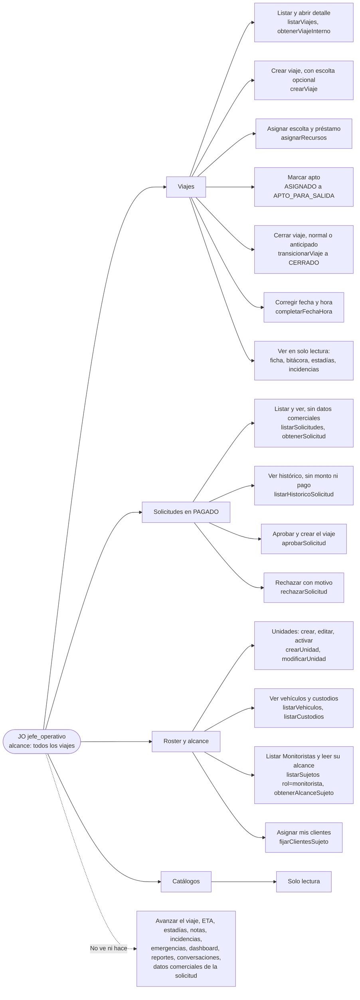

### 1.2 Monitorista (MON)

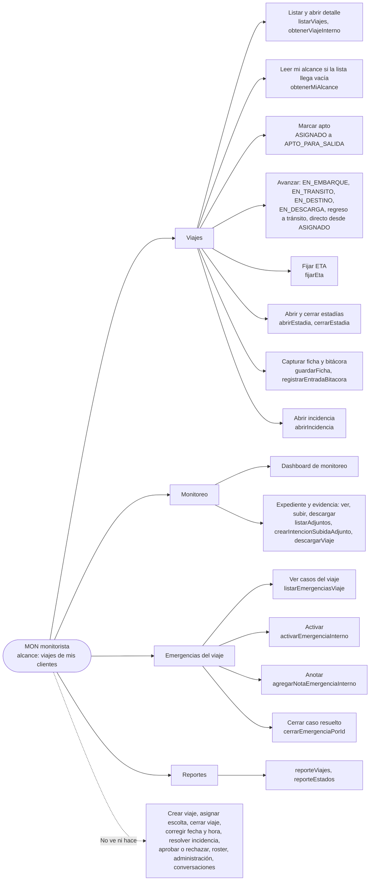

### 1.3 Supervisor (SUP) y Coordinador (COO)

Heredan todo lo del Monitorista. Su alcance es la unión de los clientes de sus subordinados.

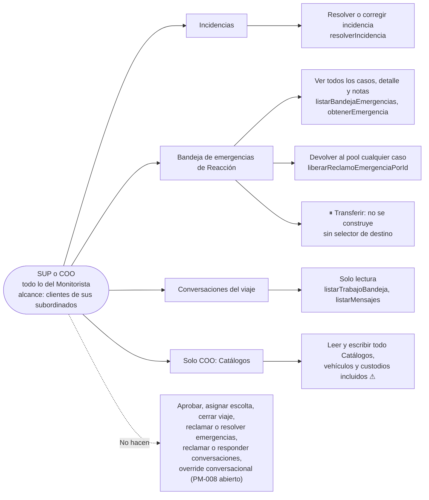

### 1.4 Administrador (ADM)

Hace todo lo de JO, MON, SUP, COO y COT, y además administra. Las excepciones se marcan.

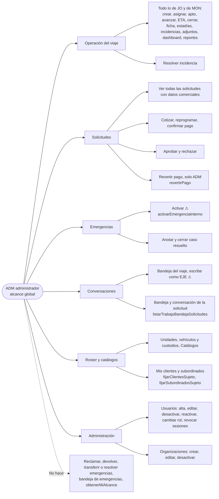

### 1.5 Ejecutivo (EJE)

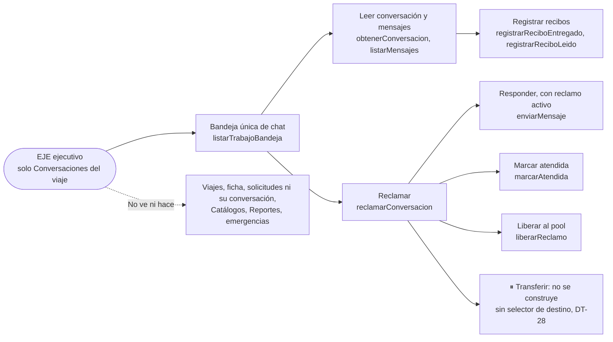

### 1.6 Reacción (REA)

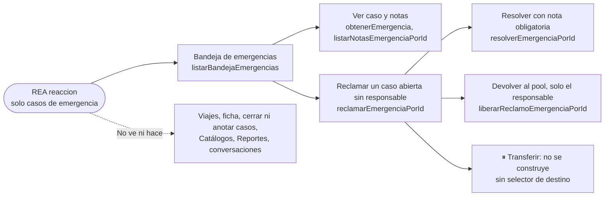

### 1.7 Cotización (COT)

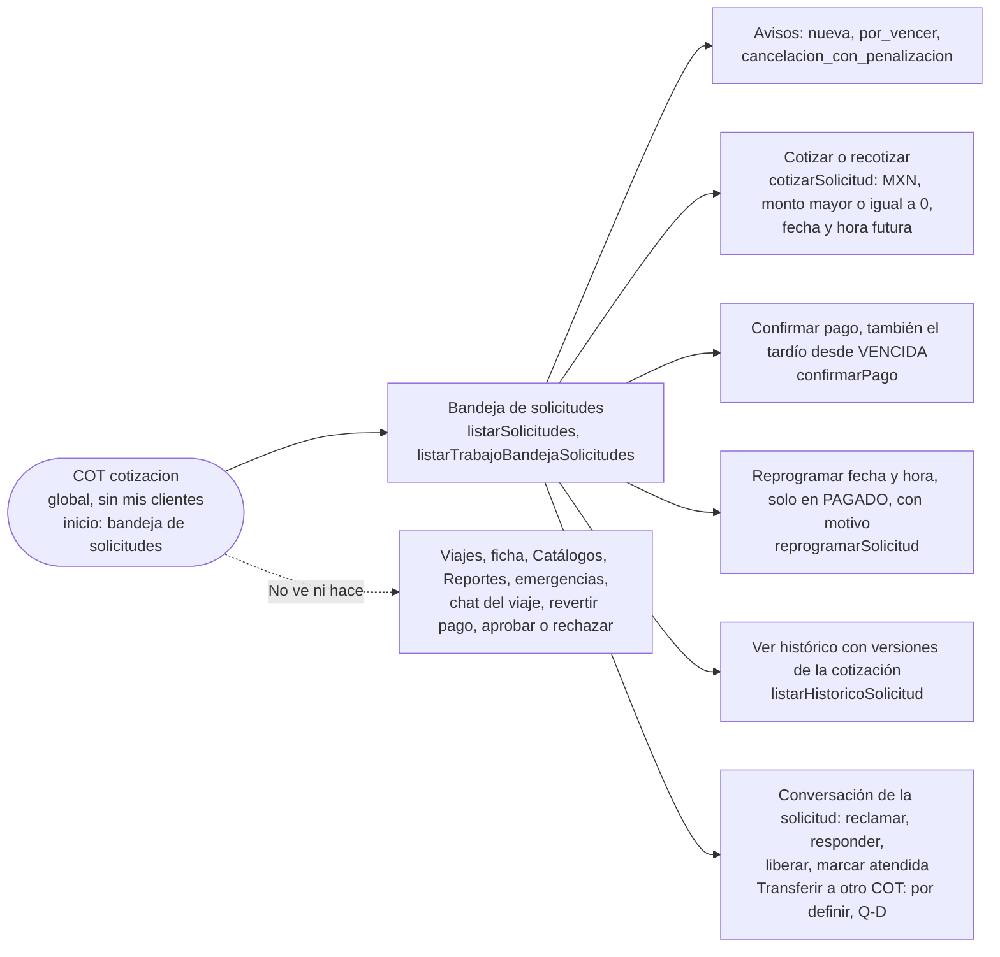

---

## 2. Máquinas de estados con el rol que dispara cada paso

### 2.1 Solicitud (`solicitud.estados.yaml`, `tracer.46`)

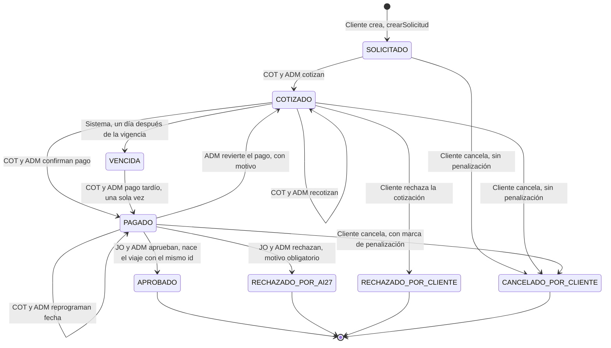

El JO solo ve solicitudes en `PAGADO`. Al aprobar o rechazar, `obtenerSolicitud` le responde `404` y el panel lo trata como solicitud resuelta.

### 2.2 Viaje (`viaje.estados.yaml`, `tracer.46`)

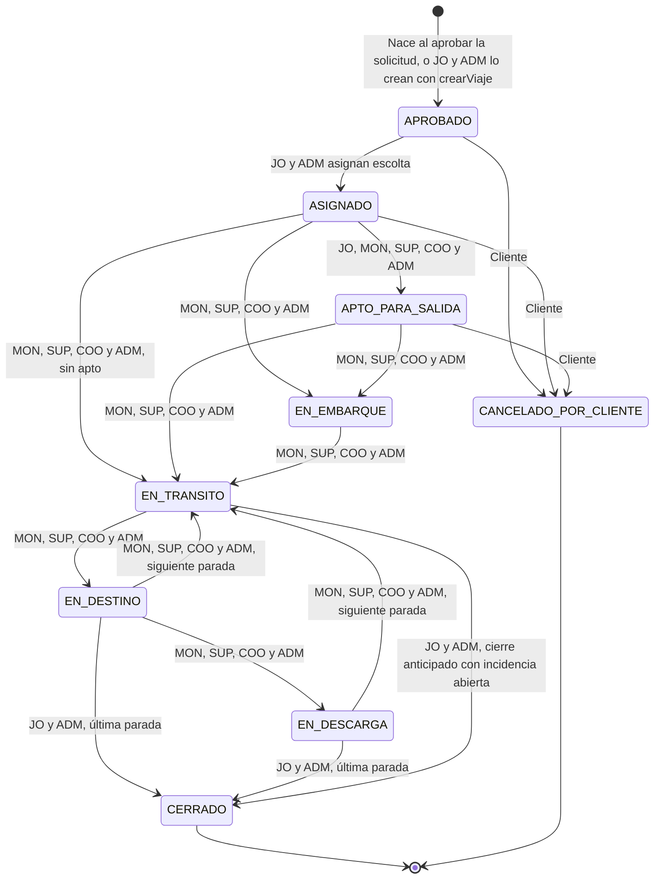

El panel interno nunca ofrece las aristas del Cliente. Durante el viaje, además de las transiciones, MON, SUP, COO y ADM operan ETA, estadías, bitácora, incidencias, adjuntos y emergencias; JO solo lee ficha, bitácora, estadías e incidencias.

### 2.3 Emergencia

```mermaid
stateDiagram-v2
  [*] --> abierta : MON, SUP, COO y ADM ⚠ activan sobre un viaje no terminal
  abierta --> en_atencion : REA reclama
  en_atencion --> abierta : Responsable REA, SUP o COO devuelven al pool
  en_atencion --> en_atencion : Transferencia a otro REA (el contrato la permite; el panel no la ofrece)
  en_atencion --> resuelta : Solo el responsable REA, con nota obligatoria
  resuelta --> cerrada : MON, SUP, COO en su alcance, o ADM
  cerrada --> [*]
```

Las notas las agregan MON, SUP, COO y ADM mientras el caso no esté `cerrada`. REA consulta las notas y no escribe.

---

## 3. Happy Paths

Cada ruta indica quién actúa, con qué operación y qué se espera. Las rutas HP-01, HP-05, HP-06 y HP-08 traen diagrama. Cada ruta empieza con el login del rol que actúa (`iniciarSesion`).

### HP-01. De la solicitud al viaje cerrado (camino completo)

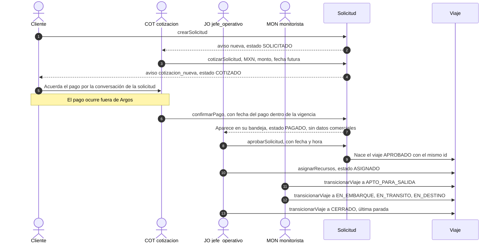

| #   | Rol                  | Acción (operación)                                                              | Resultado esperado                                                                                              |
| --- | -------------------- | ------------------------------------------------------------------------------- | --------------------------------------------------------------------------------------------------------------- |
| 1   | Cliente              | `crearSolicitud` (portal del cliente)                                           | Solicitud en `SOLICITADO`; conversación de la solicitud creada                                                  |
| 2   | COT                  | Abrir bandeja; `listarSolicitudes`                                              | Ve la solicitud con el aviso `nueva`                                                                            |
| 3   | COT                  | `cotizarSolicitud`: MXN, monto mayor o igual a 0, fecha y hora futura           | Pasa a `COTIZADO`; vigencia de 15 días; el cliente recibe `cotizacion_nueva`                                    |
| 4   | COT                  | Conversación de la solicitud: `reclamarConversacion`, `enviarMensaje`           | Acuerda el pago con el cliente                                                                                  |
| 5   | COT                  | `confirmarPago` con la fecha del pago                                           | Pasa a `PAGADO`; sin aviso al cliente                                                                           |
| 6   | JO                   | Abrir Solicitudes; `listarSolicitudes`, `obtenerSolicitud`                      | Solo ve `PAGADO`; `cotizacion` y `pago` llegan en `null` y no se pintan                                         |
| 7   | JO                   | `aprobarSolicitud` con fecha y hora futura                                      | Solicitud `APROBADO`; nace el viaje `APROBADO` con el mismo id; `obtenerSolicitud` responde `404` y no es error |
| 8   | JO                   | Abrir el viaje (`obtenerViajeInterno`); `asignarRecursos`                       | Viaje `ASIGNADO`                                                                                                |
| 9   | MON (de ese cliente) | `listarViajes`; `transicionarViaje` a `APTO_PARA_SALIDA`                        | Estado `APTO_PARA_SALIDA`                                                                                       |
| 10  | MON                  | `fijarEta`, `guardarFicha`, `registrarEntradaBitacora`                          | ETA y ficha guardados; JO los ve en solo lectura                                                                |
| 11  | MON                  | `transicionarViaje` a `EN_EMBARQUE`, `EN_TRANSITO`, `EN_DESTINO`, `EN_DESCARGA` | Cada estado queda con su marca de tiempo                                                                        |
| 12  | JO                   | `transicionarViaje` a `CERRADO`                                                 | Viaje `CERRADO` y terminal                                                                                      |

Variantes del mismo camino: en el paso 8 puede asignar ADM; en el 9 y el 11 pueden actuar SUP, COO o ADM; sin pasar por `APTO_PARA_SALIDA`, el avance directo desde `ASIGNADO` es de MON, SUP, COO y ADM.

### HP-02. Viaje creado por Operación (sin cotización)

| #   | Rol      | Acción (operación)                           | Resultado esperado                                        |
| --- | -------- | -------------------------------------------- | --------------------------------------------------------- |
| 1   | JO o ADM | `listarClientes`; `crearViaje`               | Viaje `APROBADO`, sin solicitud ni cotización             |
| 2   | JO o ADM | `crearViaje` con asignación en el mismo acto | Viaje `ASIGNADO` en una escritura atómica                 |
| 3   | MON      | `listarViajes`                               | Lo ve solo si el cliente del viaje está en "mis clientes" |

Negativo: MON, SUP, COO, EJE, REA y COT no ven "Crear viaje" y por URL ven "sin permiso".

### HP-03. Cierre anticipado por incidencia

| #   | Rol            | Acción (operación)                                              | Resultado esperado                               |
| --- | -------------- | --------------------------------------------------------------- | ------------------------------------------------ |
| 1   | MON            | `abrirIncidencia` en un viaje `EN_TRANSITO`                     | Condición `INCIDENCIA` abierta                   |
| 2   | SUP, COO o ADM | `resolverIncidencia`                                            | Incidencia `resuelta` (MON no puede)             |
| 3   | JO o ADM       | `transicionarViaje` a `CERRADO` con motivo de cierre anticipado | Viaje `CERRADO` (requiere la incidencia abierta) |

### HP-04. Estadía durante el recorrido

| #   | Rol | Acción (operación)              | Resultado esperado                            |
| --- | --- | ------------------------------- | --------------------------------------------- |
| 1   | MON | `abrirEstadia` en `EN_TRANSITO` | El viaje sigue `EN_TRANSITO`; estadía abierta |
| 2   | MON | `cerrarEstadia`                 | Duración derivada de inicio y cierre          |
| 3   | JO  | Abrir histórico                 | Ve las estadías en solo lectura, sin botones  |

### HP-05. Emergencia de punta a punta

```mermaid
sequenceDiagram
  autonumber
  actor MON as MON monitorista
  actor REA as REA reaccion
  actor SUP as SUP supervisor
  participant C as Caso de emergencia
  MON->>C: activarEmergenciaInterno, viaje no terminal
  C-->>REA: Aparece en la bandeja, estado abierta
  REA->>C: reclamarEmergenciaPorId
  MON->>C: agregarNotaEmergenciaInterno
  REA->>C: resolverEmergenciaPorId, con nota obligatoria
  MON->>C: cerrarEmergenciaPorId
  Note over SUP,C: SUP y COO pueden devolver cualquier caso en atención; transferir no se ofrece en el panel
```

| #   | Rol                             | Acción (operación)                                    | Resultado esperado                                                      |
| --- | ------------------------------- | ----------------------------------------------------- | ----------------------------------------------------------------------- |
| 1   | MON, SUP, COO (o ADM ⚠)         | `activarEmergenciaInterno`                            | Caso `abierta`; si el viaje es terminal, `409 viaje_en_estado_terminal` |
| 2   | REA                             | `listarBandejaEmergencias`; `reclamarEmergenciaPorId` | Caso `en_atencion` con responsable                                      |
| 3   | MON, SUP, COO o ADM             | `agregarNotaEmergenciaInterno`                        | Nota visible; REA la consulta sin poder escribir                        |
| 4   | REA (responsable)               | `resolverEmergenciaPorId` con nota                    | Caso `resuelta` (irreversible)                                          |
| 5   | MON, SUP, COO en alcance, o ADM | `cerrarEmergenciaPorId`                               | Caso `cerrada`; fuera de la bandeja de REA                              |

Alternos: SUP o COO `liberarReclamoEmergenciaPorId` devuelve el caso a `abierta`; `transferirEmergenciaPorId` existe en el contrato, pero el panel no lo ofrece (sin selector de destino). REA no puede cerrar y MON no puede reclamar ni resolver.

### HP-06. Conversación del viaje con el cliente

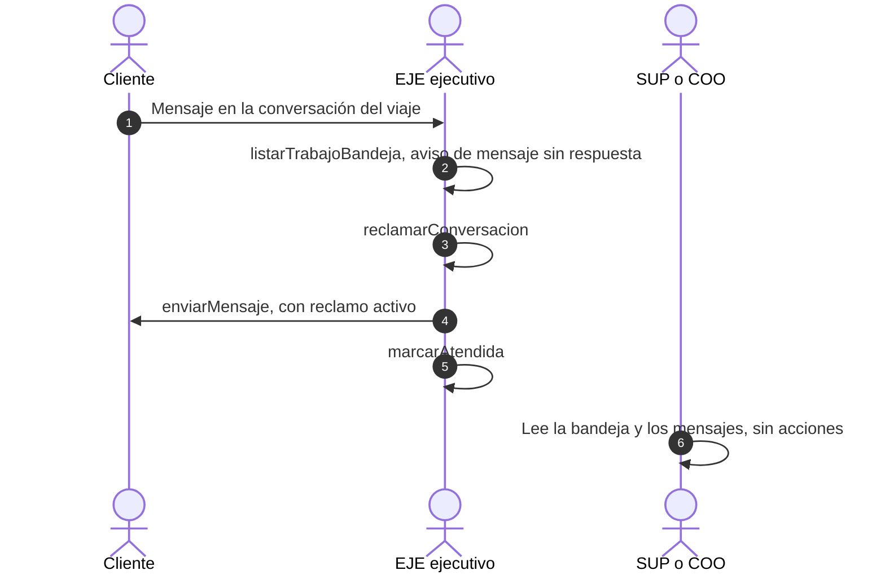

| #   | Rol       | Acción (operación)                       | Resultado esperado                                                                                                 |
| --- | --------- | ---------------------------------------- | ------------------------------------------------------------------------------------------------------------------ |
| 1   | EJE       | `listarTrabajoBandeja`                   | Ve la conversación con la marca `sin_respuesta`                                                                    |
| 2   | EJE       | `reclamarConversacion`                   | Es el responsable; otro EJE recibe `409 conflicto_version_reclamo`                                                 |
| 3   | EJE       | `enviarMensaje`                          | Mensaje entregado; el orden es por `secuencia`                                                                     |
| 4   | EJE       | `marcarAtendida`                         | Conversación atendida; responder no la marca sola                                                                  |
| 5   | EJE       | `liberarReclamo`                         | Vuelve al pool                                                                                                     |
| 6   | SUP o COO | `listarTrabajoBandeja`, `listarMensajes` | Solo lectura; reclamar o responder da `403`                                                                        |
| 7   | ADM ⚠     | La misma bandeja                         | Hoy `404` hasta el cambio en `mensajeria`                                                                          |
| 8   | EJE       | `transferirConversacion`                 | No se construye: el destino es el `sub` del token y el panel no lo conoce (`409 destino_invalido_en_viaje`; DT-28) |

### HP-07. Conversación de la solicitud (pool de cotización)

| #   | Rol         | Acción (operación)                                                             | Resultado esperado                                                                                                                                                                      |
| --- | ----------- | ------------------------------------------------------------------------------ | --------------------------------------------------------------------------------------------------------------------------------------------------------------------------------------- |
| 1   | COT o ADM   | `listarTrabajoBandejaSolicitudes`                                              | Ve las conversaciones de solicitud con `tipo=solicitud`                                                                                                                                 |
| 2   | COT         | `reclamarConversacion`, `enviarMensaje`, `marcarAtendida`                      | Atiende al cliente                                                                                                                                                                      |
| 3   | EJE         | Abrir la conversación por id                                                   | `403`; EJE nunca la ve                                                                                                                                                                  |
| 4   | Cliente     | Solicitud terminada                                                            | COT y cliente conservan 3 días de escritura; luego solo lectura                                                                                                                         |
| 5   | COT o ADM ⚠ | `transferirConversacion` con el `UsuarioAdmin.id` de otro usuario `cotizacion` | Pasa al destino; `409 destino_no_es_cotizacion` si no tiene el rol. Pendiente Q-D: COT no puede listar usuarios, así que solo ADM podría elegir destino. Backend en `-m`, sin desplegar |

### HP-08. Alta de un Monitorista y "mis clientes"

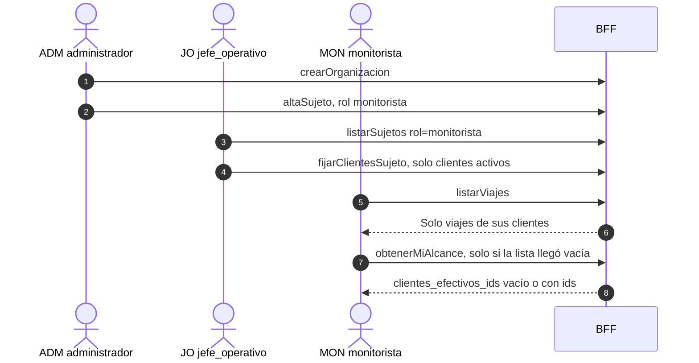

| #   | Rol                           | Acción (operación)                                                      | Resultado esperado                                                            |
| --- | ----------------------------- | ----------------------------------------------------------------------- | ----------------------------------------------------------------------------- |
| 1   | ADM                           | `crearOrganizacion`; `altaSujeto` con rol `monitorista`                 | Usuario y organización creados                                                |
| 2   | JO o ADM                      | `listarSujetos` (JO solo con `rol=monitorista`); `obtenerAlcanceSujeto` | Ve las listas de clientes del Monitorista                                     |
| 3   | JO o ADM                      | `fijarClientesSujeto`                                                   | `204`; un cliente puede estar en varios Monitoristas                          |
| 4   | MON                           | `listarViajes`                                                          | Ve solo viajes de esos clientes                                               |
| 5   | MON sin clientes              | `listarViajes` vacío; `obtenerMiAlcance`                                | Mensaje "sin clientes asignados"                                              |
| 6   | MON con clientes y sin viajes | `listarViajes` vacío; `obtenerMiAlcance` con ids                        | Mensaje "sin viajes"                                                          |
| 7   | JO                            | Cliente asignado que se desactivó                                       | Se muestra el id con la marca "desactivado" y se quita del payload al guardar |
| 8   | ADM                           | Cliente desactivado                                                     | Se muestra con su nombre (`listarOrganizaciones`) y se quita del payload      |
| 9   | ADM                           | `fijarSubordinadosSujeto` (Supervisor o Coordinador)                    | SUP y COO ven la unión de los clientes de sus subordinados                    |

### HP-09. Caminos alternos de la solicitud

| #   | Escenario            | Rol y acción                                              | Resultado esperado                                                            |
| --- | -------------------- | --------------------------------------------------------- | ----------------------------------------------------------------------------- |
| a   | Rechazo de AI27      | JO o ADM `rechazarSolicitud` con motivo                   | `RECHAZADO_POR_AI27`; no nace viaje; el cliente ve el motivo                  |
| b   | Pago por error       | ADM `revertirPago` con motivo, en `PAGADO`                | Regresa a `COTIZADO`; queda en el histórico                                   |
| c   | Cotización vencida   | Sistema marca `VENCIDA`                                   | Ninguna acción salvo pago tardío                                              |
| d   | Pago tardío          | COT o ADM `confirmarPago` con fecha dentro de la vigencia | `VENCIDA` pasa a `PAGADO`, una sola vez; un segundo intento da `409`          |
| e   | Reprogramar          | COT o ADM `reprogramarSolicitud` con motivo, en `PAGADO`  | La fecha cambia; sin pago nuevo ni cambio de estado                           |
| f   | Recotizar            | COT o ADM `cotizarSolicitud` en `COTIZADO`                | Nueva versión; la vigencia corre desde la última entrega                      |
| g   | Fecha pasada         | JO o ADM `aprobarSolicitud` con fecha ya pasada           | `409 fecha_hora_servicio_pasada` visible como error de validación             |
| h   | Cancelación con pago | Cliente cancela en `PAGADO`                               | `CANCELADO_POR_CLIENTE` con marca de penalización; COT y ADM reciben el aviso |

### HP-10. Negativos por rol (para pruebas de política)

| Rol                    | Acción intentada                                                  | Resultado esperado                                             |
| ---------------------- | ----------------------------------------------------------------- | -------------------------------------------------------------- |
| JO                     | Avanzar, fijar ETA, abrir estadía o escribir bitácora             | Acción oculta en el panel ⚠ (el backend aún no devuelve `403`) |
| JO                     | Ver monto, moneda, notas o pago de una solicitud                  | No se ven; llegan `null`                                       |
| MON, SUP, COO          | Crear viaje, asignar escolta, cerrar viaje                        | Acción oculta; por URL "sin permiso"                           |
| MON, SUP, COO          | Corregir fecha y hora del viaje                                   | Oculta (solo JO y ADM)                                         |
| MON                    | Resolver incidencia                                               | Oculta (solo SUP, COO y ADM)                                   |
| EJE, REA, COT          | Abrir `/viajes`, `/viajes/$id` o `/viajes/$id/ficha`              | "Sin permiso", sesión intacta, sin pedir la asignación         |
| EJE, REA, COT          | Abrir Catálogos o Reportes                                        | No aparecen en el menú                                         |
| SUP, COO               | Reclamar o resolver emergencia; reclamar o responder conversación | Acción oculta; el backend responde `403`                       |
| REA                    | Anotar o cerrar caso                                              | Acción oculta                                                  |
| MON, ADM               | Abrir la bandeja de emergencias                                   | No aparece en el menú; el backend responde `403`               |
| JO, ADM, EJE, REA, COT | Llamar `obtenerMiAlcance`                                         | El panel no la llama                                           |
| MON de otro cliente    | Abrir por URL un viaje fuera de su alcance                        | `404` "viaje no encontrado"                                    |
| COT                    | Revertir pago, aprobar o rechazar                                 | Oculta (revertir es solo ADM; aprobar y rechazar, JO y ADM)    |

---

## 4. Orden sugerido para armar los Happy Paths

1. **HP-08** (alcance), porque define qué viajes ve cada Monitorista.
2. **HP-02** (viaje creado por Operación), el camino más corto a un viaje real sin depender de solicitudes.
3. **HP-03 y HP-04** (operación del viaje).
4. **HP-05** (emergencia) y **HP-06** (conversación).
5. **HP-01, HP-07 y HP-09** (solicitudes), que dependen del pin `tracer.46` y del módulo M14.

Las marcas ⚠ y ⏸ indican qué pasos fallarán contra el backend real aunque el panel esté bien construido.

## 5. Fuentes

`requirements.md` (matrices M1 a M14 y "Decisiones del Lead"); `BRECHAS.md` (BE-1 a BE-7); `bff.yaml`, `viaje.estados.yaml` y `solicitud.estados.yaml` de `v0.1.0-tracer.46`; DEC-148 #1 a #76; DEC-149 #1 a #24; DEC-045; DEC-122 a DEC-135; ADR 21, 38 y 39; `BRIEF-FRONTENDS.md` (2026-11-24); casos de prueba `E10-cotizacion-pago-casos.md` (42 casos, para los e2e).
