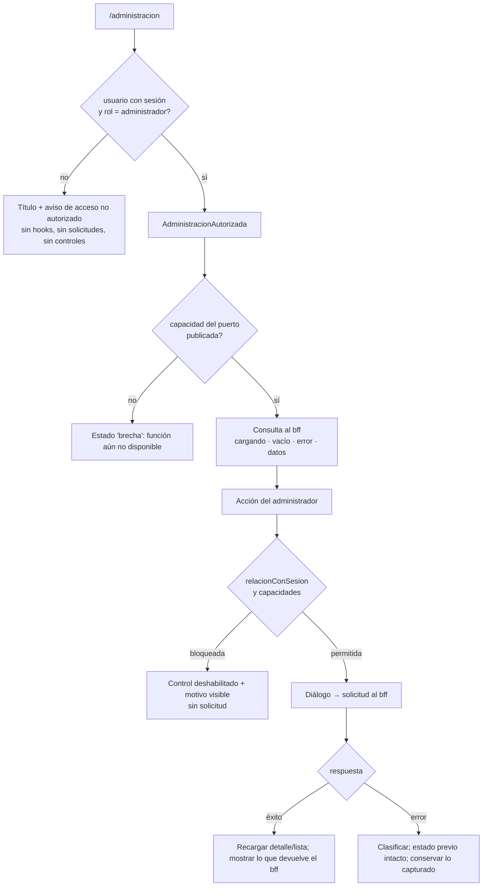

# Design Document

## Overview

Diseño de la **administración de usuarios, roles y organizaciones** (E8-T19): la pantalla `/administracion` del panel interno donde el `administrador` da de alta y desactiva usuarios, les asigna uno de los ocho roles, define su alcance de monitoreo, administra organizaciones cliente y revoca todas las sesiones de un usuario. Se construye sobre las convenciones de `pf-web-frontend-internal` (TanStack Router por archivos, capas `lib/contracts` → `lib/api` → `features`, TanStack Query, `@ai27-tech/ui`), igual que E8-T11, E8-T15 y E8-T17.

**Este diseño parte de una brecha contractual.** El `bff` no expone sujetos, roles, organizaciones, listado de sujetos, alcance ni revocación masiva (`BRECHAS.md`, B-1 a B-5). Por eso el diseño separa dos bloques:

- **Construible hoy:** guarda de rol (navegación y ruta), esqueleto de la pantalla con estados de carga, vacío, error y "brecha", selector de roles desde el enum `Rol`, bloqueo de auto-escalada en la interfaz, validaciones de formularios, estados de los diálogos y todo lo que no llama a una operación inexistente.
- **Condicionado:** cualquier llamada a sujetos, organizaciones, alcance o revocación. Se diseña detrás de un **puerto** (`AdministracionPort`) cuya forma se declara "condicionada a B-n" y se confirma cuando el contrato se publique. Hoy no hay adaptador HTTP; el puerto solo tiene una implementación "no publicada" y dobles de prueba.

El frontend no resuelve dominio. Autorización, auto-escalada del servidor, regla del último administrador, aislamiento de tenant, revocación y auditoría las aplica el `bff`/`identidad`. La interfaz deriva **afordancias** (qué control mostrar o habilitar) y **clasifica respuestas**; la decisión del servidor prevalece siempre.

### Fuentes y versiones verificadas

- **Contexto:** `ai27-platform-context` en `a55713c` (sin commits por traer en `origin/main`). DEC-022, DEC-036, DEC-045, DEC-053/054, DEC-072, DEC-091, DEC-103, DEC-137 y DEC-138.
- **Contrato:** último tag publicado `v0.1.0-tracer.37` (`d2a3de2`). El `package.json` y `pnpm-lock.yaml` fijan `tracer.36`; para esta superficie ambos son idénticos. Además, `node_modules/@ai27-tech/contracts` resuelve hoy a `tracer.37` (ver B-9). No se sube el pin.
- **UI:** `@ai27-tech/ui@0.2.0-beta.6`, verificada en `node_modules` (sección "Componentes de `@ai27-tech/ui`").

### Hecho de contrato verificado (fundamento del diseño)

Lo que el `bff` expone hoy y que este diseño usa:

```
GET /api/v1/unidades      listarUnidades    → PaginaUnidades { items: Unidad[], cursor_siguiente }   (selector de unidades, R6.1)
GET /api/v1/sesion ...    iniciarSesion / refrescarSesion / cerrarSesion                              (sesión propia, AppShell)
```

`Unidad` trae `id`, `vehiculo_id`, `custodios_ids[]`, `tipo` y `activa`; **no trae un nombre o etiqueta legible** (B-16). `Cliente` (`listarClientes`) trae `id`, `nombre` y `estado`; el contrato no define su relación con "Organización" y el diseño **no las equipara**.

Lo que **no existe** en el `bff` (`bff.gen.ts` no contiene sujetos, roles, organizaciones, alcance ni revocación): B-1 a B-5. `identidad` define seis operaciones sobre sujetos y una de sesión, pero no es pública (DEC-137). Se citan solo como **referencia de la forma probable** de la proyección futura y **no son llamables desde el frontend**:

```
# Referencia (identidad.gen.ts, NO llamable desde el frontend; el bff podría proyectarlas con otros operationId)
altaSujeto           POST   /sujetos              AltaSujetoEntrada { nombre, identificador_usuario, rol, tenant_id }
obtenerSujeto        GET    /sujetos/{id}         SujetoDetalle { sujeto { id, idp_subject?, tenant_id, activo }, tiene_rol, rol? }
desactivarSujeto     DELETE /sujetos/{id}         revoca la sesión viva en ≤30 s; 409 si deja sin administrador
reactivarSujeto      POST   /sujetos/{id}/reactivacion
fijarRolSujeto       PUT    /sujetos/{id}/rol     AsignacionRolEntrada { rol }; 403 auto-escalada; 409 desactivado | rol igual | último administrador
listarHistorialSujeto GET   /sujetos/{id}/historial  (cursor)   ← sin vista en V1 (R12.2)
```

Tres consecuencias de esa referencia que el diseño absorbe como **puntos abiertos**, no como decisiones:

1. `SujetoDetalle` **no incluye nombre ni identificador de usuario**, que R2, R3.6, R8.1 y R11.1 necesitan (B-15).
2. `Sujeto.id` y el claim `sub` del token **son distintos** (`sub` es opaco, DEC-072); la interfaz hoy solo conoce `sub` (B-14).
3. `AsignacionRolEntrada` recibe solo `rol`; no hay lugar para la organización cuando un usuario pasa a `cliente` (R4.4, R4.8; B-17).

## Architecture

### Qué se puede construir hoy y qué está condicionado

| Bloque                 | Qué incluye                                                                                                                                                 | Requisitos                                                   | Estado                                                             |
| ---------------------- | ----------------------------------------------------------------------------------------------------------------------------------------------------------- | ------------------------------------------------------------ | ------------------------------------------------------------------ |
| **A. Construible hoy** | `puedeAdministrar` + `visiblePara` en la entrada "Administración" + guarda de la ruta con aviso de acceso no autorizado                                     | R1.1 a R1.3                                                  | Sin contrato nuevo (B-12)                                          |
|                        | Selector de roles desde el enum `Rol` (8 valores, sin Auditor)                                                                                              | R1.6, R3.1 (parte de UI), R5.1, R12.3                        | Sin contrato nuevo                                                 |
|                        | Funciones puras: `relacionConSesion`, `capacidades`, `validarAlta`, `validarOrganizacion`, `organizacionesOfrecibles`, `clasificarError`, `mensajesDeExito` | R3.2 a R3.5, R4.1 a R4.4, R7, R8.8, R8.9, R9.11, R11.11, R12 | Sin contrato nuevo                                                 |
|                        | Esqueleto de secciones con estados `brecha` · `cargando` · `vacio` · `error` · `datos` y reintento                                                          | R2.5, R2.7, R2.8, R9.9, R9.13, R13.1, R13.2                  | Sin contrato nuevo; la forma `datos` se prueba con puerto falso    |
|                        | Estados y foco de los diálogos (alta, rol, desactivar, revocar, organización)                                                                               | R13.4, R13.10, R13.11                                        | Sin contrato nuevo                                                 |
|                        | Bloqueo de auto-escalada en la interfaz y sus exclusiones                                                                                                   | R7.1, R7.2, R7.5 a R7.7, R6.5, R12                           | Sin contrato nuevo; la identificación del objetivo depende de B-14 |
|                        | Selector de unidades alimentado por `listarUnidades` (lectura)                                                                                              | R6.1 (solo opciones)                                         | Existe; guardar el alcance depende de B-4                          |
| **B. Condicionado**    | Listar, buscar y paginar usuarios                                                                                                                           | R2.1, R2.2, R2.8                                             | B-2                                                                |
|                        | Detalle, alta, cambio de rol, desactivar y reactivar                                                                                                        | R2.3, R2.6, R2.9, R3, R5, R7.3, R7.4, R8                     | B-1 (+ B-7, B-15, B-17)                                            |
|                        | Alcance de monitoreo                                                                                                                                        | R2.4, R6                                                     | B-4 (bloqueada por PA-3) y B-2                                     |
|                        | Organizaciones y su desactivación con consecuencia                                                                                                          | R4, R9, R10                                                  | B-3 (+ B-2)                                                        |
|                        | Revocación masiva de sesiones                                                                                                                               | R11                                                          | B-5 (y PA-5 para el e2e)                                           |

### Vista de capas

```
routes/_private/administracion.tsx            (reemplaza el stub de E8-T4; monta <Administracion />)
        │
        ▼
features/administracion/
  Administracion.tsx            título siempre visible; guarda por rol; aviso de acceso no autorizado
  AdministracionAutorizada.tsx  solo se monta si el rol es administrador: aquí viven los hooks con red
  SeccionUsuarios.tsx           búsqueda + FilterTable + paginación + estados   [cond. B-2]
  PanelUsuario.tsx              detalle + acciones del usuario abierto           [cond. B-1]
  AltaUsuarioDialog.tsx         formulario de alta                              [cond. B-1, B-3, B-7]
  CambioRolDialog.tsx           cambio de rol                                   [cond. B-1]
  AlcanceEditor.tsx             unidades | Monitoristas | Supervisores          [cond. B-4, B-2]
  DesactivarUsuarioDialog.tsx   confirmación                                    [cond. B-1]
  RevocarSesionesDialog.tsx     confirmación + estado "en curso"                [cond. B-5]
  SeccionOrganizaciones.tsx     lista + estados                                 [cond. B-3]
  OrganizacionFormDialog.tsx    crear / editar nombre, correo y teléfono        [cond. B-3]
  DesactivarOrganizacionDialog.tsx  consecuencia visible                        [cond. B-2, B-3]
  SelectorRol.tsx               8 opciones desde ROLES                          [hoy]
  SelectorOrganizacion.tsx      una organización activa                         [cond. B-3]
  EstadoBadge.tsx               Badge con texto (activo / inactivo)             [hoy]
  puedeAdministrar.ts           guarda por rol (patrón de puedeUsarMonitoreo)   [hoy]
  relacionConSesion.ts          propio | ajeno | indeterminado                  [hoy]
  afordancias.ts                capacidades(objetivo, relación, enCurso)        [hoy]
  validacion.ts                 validarAlta, validarOrganizacion, validarMotivo [hoy]
  clasificarError.ts            (operación, status, codigo) → clase de UI       [hoy]
  mensajes.ts                   textos de trabajo centralizados (PA-4)          [hoy]
  usarEnvioUnico.ts             cerrojo de un solo envío por acción y objetivo  [hoy]
  hooks: useUsuarios, useUsuario, useOrganizaciones, useAccionUsuario, useAccionOrganizacion
        │  usan
        ▼
lib/api/administracion.ts          AdministracionPort + implementación "no publicada"   [forma cond. B-1..B-5]
lib/contracts/administracion.ts    re-exporta tipos generados cuando existan; hoy solo Rol y Unidad
```

La sección activa y el usuario abierto se representan con parámetros de búsqueda (`?seccion=usuarios|organizaciones`, `?usuario=<id>`) sobre `/administracion`, como E8-T15 (`?conversacion=`). La librería no tiene `Tabs`, así que las secciones se alternan con `Button` (B-11).



### Guarda de acceso

Sigue el patrón de E8-T17: `puedeAdministrar(rol)` en `features/administracion/puedeAdministrar.ts`, con `ROLES_ADMINISTRACION = [Rol.Administrador]` (mismo estilo que `ROLES_CON_MONITOREO`). Tiene dos usos:

1. **Navegación (B-12).** `NAV_ITEMS` ya soporta `visiblePara` (lo agregó E8-T17). La entrada `administracion` pasa de `ocultarPara: []` a `visiblePara: ROLES_ADMINISTRACION`. `tests/layout/navigation-visibility.test.ts` hoy afirma que Reacción y otros roles ven "Administración" y debe actualizarse con este cambio.
2. **Ruta.** El componente `Administracion` lee `useSession().usuario` y decide en el render, igual que `DashboardMonitoreo`: el título "Administración" se muestra siempre; el contenido de gestión solo se monta en `AdministracionAutorizada`. Así los hooks de red no existen para otros roles (R1.2) y no hay redirección que oculte el aviso. Sin `usuario`, se trata como no autorizado. La guarda `_private.tsx` (`beforeLoad`) solo valida que haya sesión y no se toca.

Dentro de `AdministracionAutorizada` **ninguna acción consulta el rol local** para decidir su resultado (R1.5): se envía y se refleja la respuesta del `bff`. El rol local solo decide qué se monta. R1.2 y R1.5 se leen así: R1.2 aplica a quien no es administrador y nunca monta la pantalla; R1.5 aplica a las operaciones de la pantalla ya montada.

### Estados de la interfaz

- **Lista de usuarios:** `brecha` · `cargando` · `vacio` · `error` (reintento) · `sin_acceso` (403) · `datos` · `datos_desactualizados` (hubo `datos` y la última consulta falló).
- **Detalle de usuario:** `cargando` · `no_disponible` (404) · `error` (reintento) · `sin_acceso` · `datos`.
- **Organizaciones:** los mismos que la lista de usuarios; el vacío ofrece "crear la primera" (R9.9).
- **Diálogo de formulario:** `cerrado` · `editando` · `enviando` · `error_general` · `error_de_campo`. Al fallar siempre vuelve a `editando` con lo capturado intacto.
- **Diálogo de confirmación:** `cerrado` · `confirmando` · `enviando` · `error`. La desactivación de organización añade `consultando_consecuencia` · `error_consecuencia` · `listo` antes de `confirmando` (R10.10).
- **Acción por usuario:** `libre` · `en_curso`. Es un registro por `(sujeto, acción)` que sobrevive a cerrar el diálogo; alimenta "revocación en curso" (R11.3) y el bloqueo de doble envío (R8.6).

**Conciliación de R2.8 y R13.2.** R2.8 pide no mostrar como vigente una lista cargada antes; R13.2 pide conservar visibles los datos de la última consulta exitosa. El diseño cumple ambas con `datos_desactualizados`: los datos previos siguen visibles, atenuados y con un aviso persistente ("esta lista no es la vigente; la consulta falló") y un control de reintento. Nunca se presenta como actual y nunca se muestra el estado vacío si no hay datos que conservar.

### Afordancias puras

`relacionConSesion(objetivo, sesion)` devuelve `'propio' | 'ajeno' | 'indeterminado'`:

- Compara **identificadores**, nunca nombres (R7.7).
- Hoy `sesion.usuario.id` es el claim `sub`, que es **opaco y distinto de `Sujeto.id`** (DEC-072). La comparación válida es contra el identificador del IdP del objetivo (`idp_subject` en la referencia de `SujetoDetalle`), y solo si el `bff` lo entrega. Si no hay con qué comparar, o no hay sesión, devuelve `indeterminado`.
- `indeterminado` se trata como R7.5 (falla cerrada): se deshabilitan cambio de rol y de alcance y se muestra "no se pudo identificar la sesión". El diseño aplica lo mismo a la revocación masiva (R11.11 prohíbe ofrecerla sobre uno mismo y no se puede garantizar). Esto último es una decisión de diseño a confirmar.
- La estrategia es un punto de extensión: al cerrarse B-14 solo cambia esta función.

`capacidades(objetivo, relacion, enCurso)` devuelve `{ puedeCambiarRol, puedeEditarAlcance, puedeDesactivar, puedeReactivar, puedeRevocarSesiones, motivoBloqueo }`:

| Condición del objetivo            | Rol y alcance                                                                           | Desactivar                                                                    | Reactivar | Revocar sesiones                                  |
| --------------------------------- | --------------------------------------------------------------------------------------- | ----------------------------------------------------------------------------- | --------- | ------------------------------------------------- |
| `propio`                          | bloqueados, con texto "no se puede modificar el propio rol ni el propio alcance" (R7.1) | permitida; el `bff` rechaza solo al último administrador activo (PA-7, R8.10) | no aplica | no se ofrece; remite al cierre de sesión (R11.11) |
| `indeterminado`                   | bloqueados con aviso (R7.5)                                                             | permitida                                                                     | no aplica | bloqueada (decisión de diseño)                    |
| `ajeno` y activo                  | permitidos si tiene rol                                                                 | permitida                                                                     | no aplica | permitida                                         |
| `ajeno` e inactivo                | bloqueados (R8.8)                                                                       | no aplica                                                                     | permitida | no regulado: el `bff` decide                      |
| acción en curso para ese objetivo | esa acción se bloquea (R8.6, R11.3)                                                     |                                                                               |           |                                                   |

Reglas de alcance: los controles de alcance de monitoreo solo existen para `monitorista`, `supervisor` y `coordinador` (R6.6); jamás hay control de clientes para `ejecutivo` (R6.5, DEC-103); monitoreo y conversación nunca comparten control (R6.8). Cambiar a un rol que ya tiene el usuario **no se bloquea en el cliente**: se envía y el `bff` responde `409` (R5.6, escenario 11). Un usuario con `tiene_rol = false` se muestra como "sin rol" y solo permite asignar uno; los requisitos no lo cubren y se anota como punto a aclarar.

### Envío único

`usarEnvioUnico` combina `isPending` de la mutación con un cerrojo en `useRef`, de modo que dos confirmaciones síncronas (clic más Enter) emitan una sola solicitud. La clave es `(acción, objetivo)`. El cerrojo se libera al terminar, con éxito o error. No hay reintento automático de ninguna mutación (R13.4); el reintento es una acción del administrador.

### Componentes de `@ai27-tech/ui` (librería primero, nada nuevo)

Verificado en `node_modules/@ai27-tech/ui@0.2.0-beta.6` (tipos y bundle):

| Necesidad                                       | Componente                                                                                                     | Verificación y límite                                                                                                                                                                                                                                                                                   |
| ----------------------------------------------- | -------------------------------------------------------------------------------------------------------------- | ------------------------------------------------------------------------------------------------------------------------------------------------------------------------------------------------------------------------------------------------------------------------------------------------------- |
| Lista de usuarios con búsqueda y filtro por rol | `FilterTable` (`search`, `filters`, `toolbarActions`, `hideCount`)                                             | Es controlado: no filtra por su cuenta, compatible con R2.2. Sin total conocido, `hideCount`                                                                                                                                                                                                            |
| Paginación                                      | `Pagination`                                                                                                   | Es por número de página; se mapea a cursor como `BandejaViajes` (`page` real + `cursor_siguiente`)                                                                                                                                                                                                      |
| Organizaciones, alcance, consecuencia           | `Table`                                                                                                        | `selectedKeys` existe pero usa etiquetas fijas ("Seleccionar fila", "Select all rows") y no deshabilita filas; para el alcance se usa una columna con `Checkbox` y `aria-label` por fila                                                                                                                |
| Diálogos                                        | `Modal` (`open`, `onClose`, `title`, `footer`, `size`, `closeOnEsc`, `closeOnOverlayClick`, `showCloseButton`) | Verificado: `role="dialog"`, `aria-modal`, foco inicial dentro, trampa de Tab y devolución del foco al elemento que abrió (R13.10, R13.11). Mientras hay solicitud se pasan `closeOnEsc`, `closeOnOverlayClick` y `showCloseButton` en `false`. El botón de cerrar tiene `aria-label="Close"` en inglés |
| Formularios                                     | `Form`, `FormSection`, `FormRow`, `FormActions`, `FormField`, `Input`                                          | `FormField` conecta `error` con `role="alert"` y `aria-describedby`                                                                                                                                                                                                                                     |
| Selector de rol y de organización               | `Radio` dentro de `FormSection` (fieldset con leyenda)                                                         | `Select` **no reenvía `id`, `aria-label` ni `aria-describedby`** (su disparador es un `button` cuyo nombre es el valor mostrado), por lo que `FormField` no lo etiqueta. Con `Radio` cada opción tiene nombre y teclado nativo (R13.5)                                                                  |
| Estado activo / inactivo                        | `Badge` (`secure` / `neutral`)                                                                                 | Siempre con texto (R13.6). El contrato solo tiene `activo` booleano: no existe el estado "bloqueado"                                                                                                                                                                                                    |
| Avisos de éxito y error transitorio             | `Toast`, `ToastContainer`                                                                                      | `error`/`warning` usan `role="alert"`; patrón de `DetalleViaje` (estado local de toasts)                                                                                                                                                                                                                |
| Errores persistentes y estados vacío / carga    | `Card` + texto con `role="status"` / `role="alert"`                                                            | Patrón de `DashboardMonitoreo`; la librería no tiene componentes de alerta ni de estado vacío                                                                                                                                                                                                           |
| Acciones                                        | `Button` (`variant`, `loading`, `disabled`)                                                                    | `danger` para desactivar y revocar                                                                                                                                                                                                                                                                      |
| Cambio de sección                               | `Button`                                                                                                       | No hay `Tabs`                                                                                                                                                                                                                                                                                           |

Brechas de UI registradas en B-11, sin duplicar componentes: sin multi-select dedicado, sin `Tabs`, `Select` sin nombre accesible, `Table` con selección genérica, textos en inglés en `Modal` y `Table`, y `Pagination` numérica frente a un `bff` por cursor.

## Components and Interfaces

### Puerto de administración (`lib/api/administracion.ts`)

Una sola frontera para todo lo que aún no existe en el contrato. **Su forma está condicionada a B-1 a B-5**: los nombres son de trabajo del frontend, **no** `operationId` del `bff`, y se confirman cuando se publique. La convención del repo se mantiene: cada método recibe el `accessToken` y usa `request` de `client.ts`.

```
interface AdministracionPort {
  capacidades: { usuarios: boolean; organizaciones: boolean; alcance: boolean; revocacionMasiva: boolean }

  // Usuarios                                                          condicionado a
  listarUsuarios(consulta, token): Promise<PaginaUsuarios>             // B-2, B-15
  obtenerUsuario(id, token): Promise<UsuarioDetalle>                   // B-1, B-14, B-15
  altaUsuario(alta, token): Promise<UsuarioDetalle>                    // B-1, B-3, B-7
  fijarRol(id, rol, token): Promise<void>                              // B-1, B-17
  desactivarUsuario(id, token): Promise<void>                          // B-1
  reactivarUsuario(id, token): Promise<void>                           // B-1
  editarUsuario(id, nombre, token): Promise<void>                      // B-8 (solo nombre; PA-10)

  // Organizaciones
  listarOrganizaciones(token): Promise<Organizacion[]>                 // B-3
  crearOrganizacion(datos, token): Promise<Organizacion>               // B-3 (nombre, correo, teléfono; PA-2)
  editarOrganizacion(id, datos, token): Promise<Organizacion>          // B-3
  consultarConsecuencia(id, token): Promise<ConsecuenciaDesactivacion> // B-2, B-3
  desactivarOrganizacion(id, token): Promise<void>                     // B-3

  // Alcance
  leerAlcance(id, token): Promise<AlcanceEfectivo>                     // B-4
  fijarAlcance(id, cambio, token): Promise<AlcanceEfectivo>            // B-4

  // Sesiones
  revocarSesiones(id, motivo, token): Promise<ResultadoRevocacion>     // B-5 (motivo obligatorio; PA-1)
}
```

- **Implementación "no publicada":** `capacidades` en `false` y cada método lanza `ErrorSuperficieNoPublicada`. Las secciones muestran el estado `brecha` (mismo precedente que `ClienteSelector`, `EstadoCatalogoClientes = 'brecha'`). No hay handlers MSW para estas rutas: inventarlos fijaría rutas y campos que el contrato no define.
- **Implementación real:** un adaptador por área, escrito cuando el contrato se publique. Traduce wire → modelo de vista y clasifica errores. Es el **único** lugar con tipos generados de esta superficie.
- **Inyección:** un `AdministracionProvider` (contexto React) entrega el puerto; las pruebas inyectan dobles. Los hooks no importan el adaptador directamente.
- **Fuera del puerto, por requisito:** revocar por `sesion_id`, enumerar sesiones, consultar o exportar auditoría, historial del sujeto, editar tenant, asignar clientes a un Ejecutivo, organización padre y transferir usuarios (R6.5, R9.5, R9.6, R11.9, R12).

Dos cambios en la capa HTTP compartida que el adaptador real probablemente necesite (B-18; se coordinan al implementar, no se ejecutan en este spec):

1. `RequestOptions.method` solo admite `GET | POST | PATCH | DELETE`. La referencia de `fijarRolSujeto` es `PUT`; si el `bff` la proyecta igual, hay que admitir `PUT`.
2. `request` no tiene tiempo de espera ni `AbortSignal`. R11.3 y R11.6 hablan de "agotamiento del tiempo de espera"; sin él, una solicitud colgada deja la revocación "en curso" para siempre. El valor del tiempo de espera no se fija aquí.

### Hooks

- **`useUsuarios(consulta)`**: `useQuery` con clave `['administracion','usuarios',consulta]`, `retry: false`, sin sondeo. La consulta lleva `texto`, `rol` y `cursor`; cada búsqueda o cambio de página es una solicitud (R2.2). Un reductor puro mantiene `page` real y los cursores visitados (patrón de `bandejaReducer`). La búsqueda se retrasa unos instantes antes de consultar (el valor no se fija aquí). La vista renderiza `items` tal cual, en el orden recibido.
- **`useUsuario(id)`**: detalle con clave `['administracion','usuario',id]`. Se recarga tras cada mutación exitosa y tras `403`/`409` (R5.3, R5.7, R7.3).
- **`useOrganizaciones()`**: lista completa; alimenta la sección y el selector del alta (solo las activas, R4.1).
- **`useAccionUsuario()` / `useAccionOrganizacion()`**: `useMutation` por acción, sin actualización optimista. Tras el éxito invalidan y recargan; el estado nuevo se muestra solo cuando el `bff` lo devuelve (R8.5, R13.4). Cada una usa `usarEnvioUnico`.
- **Unidades:** el selector del alcance usa `listarUnidades`. El wrapper actual devuelve solo `pagina.items` e ignora `cursor_siguiente`; para el selector se necesita recorrer todas las páginas, como `listarTodosClientes`. Es un ajuste del wrapper al implementar R6.1.

### Clasificación de errores

`clasificarError(operación, status, codigo)` es una función pura y total; sigue el patrón de `lib/api/conversaciones.ts` (clases que extienden `ApiError` con el texto para el usuario en `message`, textos centralizados en `mensajes.ts`).

- `401` y `sesionFinalizada` se **dejan pasar**: `client.ts` ya refresca y, si no puede, ejecuta el corte de sesión. La feature no muestra mensaje ni presenta la acción como realizada (R13.3, escenario 19).
- `kindFromStatus` mapea `401` y `403` a `noAutorizado`; la feature distingue por `status`, como los hermanos.
- Los motivos de `409` en cambio de rol (`usuario_desactivado`, `rol_igual`, `ultimo_administrador`) son categorías de **presentación**. El mapeo desde `codigo` lo define el adaptador cuando B-1 publique códigos de máquina distintos; si el `codigo` no distingue, se muestra un conflicto genérico y **no se afirma un motivo** (R5.6). Lo mismo para el `403` de auto-escalada: si el `codigo` no lo distingue de otro `403`, se usa la relación capturada al enviar.

## Data Models

Los modelos de wire serán los generados del contrato cuando existan; no se redefinen. Los siguientes son **modelos de vista conceptuales** que el adaptador producirá; sus campos reflejan lo que los requisitos necesitan mostrar y se confirman contra el contrato (B-15).

```
UsuarioResumen { id, nombre, identificadorUsuario, rol | null, activo, organizacion? }        // organizacion solo si rol = cliente
UsuarioDetalle = UsuarioResumen + { alcance?: AlcanceEfectivo, idpSubject? }                   // idpSubject: ver B-14
Organizacion { id, nombre, correo, telefono, tenant, activa }                                // tenant solo lectura (R9.4); sin reactivar (PA-8)
ConsecuenciaDesactivacion { usuariosActivos: number, usuarios: { nombre, identificadorUsuario }[] }
AltaUsuario { nombre, identificadorUsuario, rol, organizacionId? }                             // sin tenant_id: la UI nunca lo captura (R3.5)
AlcanceEfectivo / CambioAlcance / ResultadoRevocacion                                           // forma por definir en B-4 y B-5
```

Estado local de la vista (no es wire):

- **`FormularioAlta`**: `{ nombre, identificadorUsuario, rol | null, organizacionId | null }`. Cambiar el rol a distinto de `cliente` **descarta** `organizacionId` del comando (R4.3), aunque siga en el estado del formulario.
- **`EstadoConsulta<T>`**: `{ estado: 'brecha'|'cargando'|'vacio'|'error'|'sin_acceso'|'datos'|'datos_desactualizados', datos?, error? }`. Los estados son excluyentes y se derivan de `isLoading`, `isError` y `data` en una sola función pura.
- **`EnCursoPorUsuario`**: mapa `(sujetoId, acción) → 'en_curso'`. Evita doble envío y alimenta los avisos persistentes.
- **`AvisoUI`**: `{ tipo: 'exito'|'error'|'auto_escalada'|'autorizacion', texto }`. El aviso de auto-escalada es independiente de la consulta del detalle: si la recarga posterior falla, se conserva (R7.4).
- **Resultado de éxito**: el texto se arma con `mensajesDeExito(acción)`, que solo emite lo que el contrato garantiza: cambio de rol → "surte efecto en el siguiente refresco" (R5.4); desactivación y revocación → "máximo 30 segundos" (R8.3, R11.4). Nunca afirma auditoría, notificación al usuario, corte inmediato ni que la sesión "ya dejó de funcionar" (R11.5, R12.1, R12.6).

## Correctness Properties

_A property is a characteristic or behavior that should hold true across all valid executions of a system-essentially, a formal statement about what the system should do. Properties serve as the bridge between human-readable specifications and machine-verifiable correctness guarantees._

Las propiedades marcadas **[cond. B-n]** se prueban hoy contra un puerto falso con la forma de este diseño y se revalidan contra el contrato real cuando la brecha se cierre.

### Property 1: Visibilidad por rol

_For any_ rol `r` del enum `Rol`, la entrada "Administración" aparece en la navegación de `r` y la pantalla monta el contenido de gestión si y solo si `r` es `administrador`; sin sesión, la pantalla no monta el contenido de gestión.

**Validates: Requirements 1.1, 1.3**

### Property 2: Sin solicitudes ni controles para quien no es administrador

_For any_ rol distinto de `administrador` que abre `/administracion`, la pantalla muestra el aviso de acceso no autorizado, emite cero llamadas al puerto y no renderiza controles de asignación de roles, alcance, desactivación, organizaciones ni revocación.

**Validates: Requirements 1.2, 1.3**

### Property 3: Las opciones de rol son exactamente el enum

_For any_ contexto en que se ofrece un selector de rol (alta, cambio de rol, filtro), las opciones son exactamente los ocho valores de `Rol` de `@ai27-tech/contracts`, sin valores adicionales (no existe Auditor) y, en el cambio de rol, con exactamente una opción marcada como rol actual del usuario.

**Validates: Requirements 1.6, 3.1, 5.1, 12.3**

### Property 4: Validez del alta y forma del comando

_For any_ `FormularioAlta` (nombre e identificador arbitrarios, incluidas cadenas vacías o solo con espacios, rol dentro o fuera del enum, organización presente o ausente), la confirmación está habilitada si y solo si nombre e identificador no están vacíos tras recortar espacios, el rol pertenece al enum y, cuando el rol es `cliente`, hay exactamente una organización activa seleccionada. Además, _for any_ formulario válido con rol distinto de `cliente`, el comando construido no contiene organización ni `tenant_id`, aunque el formulario conserve una organización seleccionada antes.

**Validates: Requirements 3.2, 3.3, 3.4, 3.5, 4.3, 4.4, 4.6** [cond. B-1, B-3, B-7]

### Property 5: Organizaciones ofrecibles

_For any_ lista de organizaciones, el selector ofrece exactamente las que tienen estado activa (cada una por su nombre), nunca una inactiva, y la selección contiene a lo más una organización.

**Validates: Requirements 4.1, 4.2, 10.7** [cond. B-3]

### Property 6: Datos de organización obligatorios

_For any_ nombre, correo o teléfono vacío o compuesto solo por espacios, o correo sin `@`, crear o guardar una organización no emite solicitud, conserva el formulario abierto e indica el campo obligatorio o inválido; _for any_ nombre y teléfono con al menos un carácter no blanco y correo que contiene `@`, la validación local los acepta. El teléfono no tiene regla de formato (PA-2).

**Validates: Requirements 9.11**

### Property 7: El sujeto de la sesión se identifica por identificador, no por nombre

_For any_ par (identificador de sesión, objetivo con identificador de IdP) y _for any_ nombres, `relacionConSesion` devuelve `propio` si y solo si ambos identificadores existen y son iguales, `ajeno` si existen y difieren, e `indeterminado` si falta alguno; cambiar el nombre del objetivo o de la sesión no cambia el resultado.

**Validates: Requirements 7.7** [cond. B-14]

### Property 8: Capacidades según relación y estado

_For any_ objetivo (activo o inactivo, con o sin rol) y _for any_ relación con la sesión, `puedeCambiarRol` y `puedeEditarAlcance` son falsos cuando la relación es `propio` o `indeterminado` o el objetivo está inactivo, y entonces `motivoBloqueo` no está vacío; `puedeRevocarSesiones` es falso cuando la relación es `propio` o `indeterminado`; `puedeDesactivar` no depende de la relación (decide el `bff`); `puedeReactivar` es verdadero solo si el objetivo está inactivo; y ninguna capacidad de la acción en curso para ese objetivo está habilitada.

**Validates: Requirements 7.1, 7.5, 8.8, 8.10, 11.11**

### Property 9: Ninguna solicitud sobre un objetivo bloqueado

_For any_ objetivo cuya relación es `propio` o `indeterminado`, o que está inactivo, y _for any_ medio de disparo (clic, tecla Enter, reenvío del formulario), un intento de cambiar su rol o su alcance produce cero llamadas al puerto.

**Validates: Requirements 7.2, 7.5, 8.8**

### Property 10: Controles de alcance según el rol del objetivo

_For any_ rol del objetivo, los controles de alcance de monitoreo existen si y solo si el rol es `monitorista`, `supervisor` o `coordinador` (y el objetivo es editable); para `ejecutivo` y para cualquier otro rol no existe ningún control de asignación de clientes, y el control de alcance de monitoreo nunca comparte componente con uno de conversación.

**Validates: Requirements 6.5, 6.6, 6.8**

### Property 11: Las opciones de alcance son solo las devueltas, filtradas por rol

_For any_ conjunto de unidades y de usuarios devueltos por el `bff`, el editor ofrece para un Monitorista exactamente las unidades devueltas, para un Supervisor exactamente los usuarios con rol `monitorista` y para un Coordinador exactamente los usuarios con rol `supervisor`; una confirmación que incluya un elemento fuera de las opciones devueltas no se emite, y una lista de opciones vacía o con error deshabilita la confirmación sin perder la selección ya capturada.

**Validates: Requirements 6.1, 6.2, 6.3, 6.11** [cond. B-2, B-4]

### Property 12: Estados de consulta excluyentes

_For any_ combinación de (cargando, error con su clase, datos presentes o ausentes, lista vacía) de una consulta de usuarios, organizaciones o detalle, `EstadoConsulta` es exactamente uno de `cargando`, `vacio`, `error`, `sin_acceso`, `datos` o `datos_desactualizado`; `vacio` solo ocurre con una respuesta exitosa sin elementos; ante un error con datos previos el estado es `datos_desactualizado` y nunca `vacio`; y sin datos previos un error nunca produce `vacio`.

**Validates: Requirements 2.5, 2.7, 2.8, 9.13, 13.1, 13.2**

### Property 13: La vista refleja lo devuelto

_For any_ respuesta del `bff` (lista de usuarios, alcance efectivo, número de usuarios activos afectados), la vista presenta exactamente esos elementos, en el mismo orden y con el mismo conteo, sin filtrar, ordenar, ampliar ni calcular uniones en el cliente; un alcance vacío muestra el mensaje de que no hay unidades, y un conteo de cero muestra que ningún usuario activo pierde el acceso.

**Validates: Requirements 2.2, 2.4, 6.4, 10.2, 10.3** [cond. B-2, B-3, B-4]

### Property 14: Un solo envío por acción y objetivo

_For any_ secuencia de `n ≥ 1` confirmaciones de la misma acción sobre el mismo objetivo mientras hay una solicitud pendiente, el puerto recibe exactamente una llamada; al terminar la solicitud, con éxito o con error, el control de envío vuelve a su estado habilitado que corresponda; y una acción en curso sobre un objetivo no bloquea la misma acción sobre otro.

**Validates: Requirements 3.10, 5.2, 8.5, 8.6, 9.10, 10.11, 11.3**

### Property 15: Solo la confirmación del `bff` cambia lo mostrado

_For any_ mutación (alta, cambio de rol, alcance, desactivar, reactivar, crear o editar organización, desactivar organización, revocar) y _for any_ resultado del puerto: si es un error (`403`, `404`, `409`, `400`, `5xx`, sin respuesta o tiempo agotado), el estado mostrado del usuario u organización es idéntico al previo, lo capturado en el formulario o diálogo se conserva, el control de envío vuelve a estar habilitado y se muestra un aviso de error (que indica "resultado no confirmado" cuando no hubo respuesta); si es un éxito, lo mostrado es lo que devuelve la recarga posterior del `bff` y nunca el valor seleccionado o capturado.

**Validates: Requirements 1.4, 3.9, 5.3, 5.6, 5.8, 6.9, 8.3, 8.4, 8.7, 9.8, 9.12, 10.8, 11.6, 13.4**

### Property 16: Clasificación total de errores

_For any_ tripleta (operación, `status`, `codigo`), `clasificarError` devuelve exactamente una clase de error de la interfaz; el `401` y la sesión finalizada se devuelven sin transformar y nunca generan mensaje ni éxito; un `409` de cambio de rol con un `codigo` conocido produce el motivo correspondiente y con un `codigo` desconocido produce un conflicto genérico que no afirma un motivo.

**Validates: Requirements 5.6, 13.3** [cond. B-1]

### Property 17: Sin efectos cruzados entre acciones

_For any_ cambio de rol o de alcance confirmado con éxito, el número de llamadas al puerto a `revocarSesiones` y a `desactivarUsuario` es cero; y _for any_ acción de revocación o de desactivación, solo se invoca el método de esa acción.

**Validates: Requirements 5.5, 8.9**

### Property 18: Ninguna solicitud destructiva antes de confirmar

_For any_ acción destructiva (desactivar usuario, revocar sesiones, desactivar organización), cero llamadas al puerto ocurren hasta que el administrador activa el control de confirmar; cancelar o cerrar el diálogo deja cero llamadas y el estado sin cambios; y la desactivación de una organización solo habilita confirmar en el estado `listo` (consecuencia obtenida), nunca en `consultando_consecuencia` ni en `error_consecuencia`.

**Validates: Requirements 8.1, 8.2, 10.4, 10.5, 10.10, 11.2**

### Property 19: Los textos de éxito se limitan a lo que el contrato garantiza

_For any_ acción exitosa y _for any_ resultado devuelto por el `bff`, el mensaje de `mensajesDeExito` no contiene afirmaciones de auditoría, bitácora, notificación al usuario, aislamiento aplicado, alcance global de Supervisor o Coordinador, corte inmediato ni "la sesión ya dejó de funcionar"; el de cambio de rol contiene la indicación de "siguiente refresco" y no afirma qué ocurre con el alcance previo; el de desactivación de usuario y el de revocación contienen el máximo de 30 segundos; y el de desactivación de organización no afirma plazos ni revocación de sesiones.

**Validates: Requirements 4.5, 5.4, 5.10, 6.10, 8.3, 10.6, 11.4, 11.5, 12.1, 12.6**

## Error Handling

Las clases de error extienden `ApiError` y llevan el texto para el usuario en `message` (textos de trabajo en `mensajes.ts`, pendientes de PA-4). Toda acción fallida deja el estado previo intacto y no se reintenta sola.

| Respuesta                                          | Clasificación                      | Comportamiento de la vista                                                                                                                     |
| -------------------------------------------------- | ---------------------------------- | ---------------------------------------------------------------------------------------------------------------------------------------------- |
| `401` / `sesionFinalizada`                         | Sesión                             | Pasa sin transformar; `client.ts` refresca o ejecuta el corte; la acción no se presenta como realizada                                         |
| `403` en cualquier operación                       | `ErrorAutorizacionInsuficiente`    | Aviso de autorización insuficiente; datos y captura sin cambios; en lecturas, estado `sin_acceso`                                              |
| `403` en cambio de rol o alcance del propio sujeto | `ErrorAutoescaladaBloqueada`       | Aviso "el servidor rechazó el cambio"; recargar el detalle; si la recarga falla se conserva el aviso y se muestra error de carga               |
| `404` en detalle                                   | `ErrorUsuarioNoDisponible`         | Aviso de usuario no disponible; sin datos de ese ni de otro usuario                                                                            |
| `409` cambio de rol                                | `ErrorConflictoRol` con motivo     | Desactivado, rol igual o último administrador, según el `codigo`; si no se distingue, conflicto genérico; conserva el rol elegido              |
| `409` desactivar (último administrador)            | `ErrorUltimoAdministrador`         | Explica el motivo; el usuario sigue activo                                                                                                     |
| `409`/`400` en alta por identificador duplicado    | `ErrorIdentificadorDuplicado`      | Mensaje junto al campo; conserva rol y organización; sin duplicado en pantalla                                                                 |
| `400` validación                                   | `ErrorValidacion`                  | Error junto al campo si `detalles.campo` se mapea; si no, aviso general del formulario                                                         |
| Rechazo por organización inválida                  | `ErrorOrganizacionInvalida`        | Mensaje junto al selector; recargar organizaciones; sin asociar al usuario                                                                     |
| Conflicto de nombre de organización                | `ErrorNombreOrganizacionDuplicado` | Conserva el formulario; la lista no cambia                                                                                                     |
| `5xx`                                              | `ErrorServicioNoDisponible`        | Acción: "no se aplicó", reintento manual. Consulta: `datos_desactualizado` o `error` según haya datos previos                                  |
| Sin respuesta (`red`) o tiempo agotado             | `ErrorServicioNoDisponible`        | Acción: "resultado no confirmado" con opción de verificar el estado recargando; revocación: "no se pudo confirmar" sin asumir que no se aplicó |
| Capacidad no publicada                             | `ErrorSuperficieNoPublicada`       | Estado `brecha` en la sección; sin controles de la acción                                                                                      |
| Sujeto de la sesión no identificable               | Afordancia                         | Controles de rol, alcance y revocación deshabilitados con aviso "no se pudo identificar la sesión"                                             |
| Revocación sobre usuario sin sesiones              | Resultado informativo              | Se muestra el resultado del `bff`; no es error                                                                                                 |

Reglas transversales: ninguna actualización optimista; el reintento de una consulta repite la misma consulta; un `403` de lectura no se confunde con un error de red; el cierre del diálogo se bloquea (Esc, overlay y botón) mientras hay solicitud pendiente.

## Testing Strategy

**Enfoque dual.** Pruebas de propiedades para la lógica pura y de coordinación; pruebas de ejemplo para estados, diálogos, foco y exclusiones. Se justifica PBT porque `capacidades`, `relacionConSesion`, `validarAlta`, `organizacionesOfrecibles`, `clasificarError`, `mensajesDeExito` y el reductor de estados son funciones puras con espacios de entrada amplios. La capa visual y de red (renderizado, `Modal`, `Toast`) se prueba con ejemplos, no con PBT.

**Propiedades.** Biblioteca `fast-check` (ya en `devDependencies`), con `vitest`. Cada propiedad se implementa con **una** prueba, mínimo 100 iteraciones, etiquetada `Feature: e8-t19-administracion-usuarios-roles-organizaciones, Property N: <título>` y ubicada junto a las existentes en `tests/` (por ejemplo `tests/administracion/`). Las propiedades 2, 9, 14, 15, 17 y 18 se ejecutan con React Testing Library y un **puerto falso** inyectado por `AdministracionProvider`, con espías por método.

**Pruebas de ejemplo:**

- Guarda: navegación y ruta por rol; actualizar `tests/layout/navigation-visibility.test.ts`, que hoy espera "Administración" para Reacción y otros roles.
- Diálogos: foco inicial dentro, Tab atrapado y foco devuelto al elemento que abrió; respaldo al encabezado de la sección cuando el elemento ya no existe (R13.10, R13.11).
- Accesibilidad: nombre accesible no vacío en cada control, `Radio` de rol y organización con leyenda, columna `Checkbox` del alcance con `aria-label` por fila, `Badge` con texto, operación completa con teclado (R13.5, R13.6).
- Exclusiones de V1: no existen controles de auditoría, break-glass, transferencia, edición de tenant, organización padre, reactivación de organizaciones, edición del identificador de usuario ni revocación por `sesion_id` (R9.5 a R9.7, R11.9, R11.10, R12.2 a R12.5).
- Escenarios 9, 10 y 13: DoD 1 completo y la parte de interfaz de DoD 2 con el sujeto de la sesión simulado.
- Verificación estructural del puerto: el conjunto de métodos de `AdministracionPort` es el declarado y no incluye los excluidos.

**Sin mocks de red para las rutas faltantes.** No se agregan handlers a `src/mocks/handlers.ts` para sujetos, organizaciones, alcance o revocación: inventarían rutas y campos. Para ver la pantalla en `dev:mock` se puede añadir una credencial demo con rol `administrador` (usa el contrato de sesión, que sí existe); hoy la demo es `jefe_operativo`. Con la capacidad no publicada se verá el estado `brecha`.

**Contrato.** `typecheck` sobre los tipos generados; el adaptador real se prueba contra MSW solo cuando el contrato publique las operaciones. Subir el pin a `tracer.37` o posterior requiere aprobación, y cada criterio CONDICIONADO se reverifica entonces.

**No ejecutables todavía:** el e2e de revocación masiva con dos sesiones (DoD 3) depende de B-5 y de PA-5 (DEC-138), y la prueba de que el servidor rechaza la auto-escalada con `403` (DoD 2) depende de B-1.

## Decisiones de diseño

1. **Puerto por feature en vez de cliente HTTP directo.** Aísla la superficie inexistente en un punto. Cuando el contrato se publique solo se escribe el adaptador; los componentes no cambian.
2. **Estado `brecha` en vez de ocultar secciones o simular datos.** Hace visible lo que falta sin inventar rutas ni campos (precedente: `ClienteSelector`).
3. **Guarda en el render del componente, no en `beforeLoad`.** Es el patrón de `DashboardMonitoreo`, deja ver el aviso exigido por R1.2 y evita montar hooks de red para otros roles.
4. **Identificación del sujeto de la sesión con falla cerrada.** Como `sub` es opaco y distinto de `Sujeto.id`, sin identificador comparable la relación es `indeterminado` y se bloquea (R7.5). Se paga con no poder editar a nadie hasta cerrar B-14, a cambio de no permitir auto-escalada accidental. El `bff` sigue siendo la barrera real.
5. **`Radio` en vez de `Select` para roles y organizaciones.** El `Select` de la librería no expone nombre accesible (R13.5). El cambio vuelve a `Select` si la librería lo corrige; el punto de cambio es `SelectorRol` y `SelectorOrganizacion`.
6. **Columna `Checkbox` en `Table` para el alcance en vez de `selectedKeys`.** La selección integrada tiene etiquetas genéricas y no deshabilita filas. No hay multi-select dedicado (B-11).
7. **`datos_desactualizado` concilia R2.8 y R13.2.** Datos previos visibles pero marcados como no vigentes, con reintento.
8. **Cambiar al rol que ya tiene no se bloquea en el cliente.** El `bff` responde `409` y la interfaz muestra el motivo (R5.6, escenario 11).
9. **Sin actualización optimista ni reintento automático.** Alineado con R13.4 y con la regla de los hermanos de recargar tras `409`.
10. **Textos centralizados y marcados como de trabajo.** PA-4 sigue abierto; cambiarlos es editar `mensajes.ts`.

### Puntos de extensión (preguntas abiertas que el diseño no resuelve)

| Pregunta                                 | Dónde queda el punto de extensión                                                                                         |
| ---------------------------------------- | ------------------------------------------------------------------------------------------------------------------------- |
| PA-1 motivo de revocación (decidida)     | `RevocarSesionesDialog` exige un motivo de texto libre; confirmar deshabilitado si está vacío; el puerto recibe `motivo`  |
| PA-2 contacto de organización (decidida) | `OrganizacionFormDialog` y `Organizacion` llevan nombre, correo (con `@`) y teléfono (sin formato), los tres obligatorios |
| PA-3 vínculo Monitorista↔unidad          | `fijarAlcance` y `AlcanceEditor`; no se define cuándo ni cómo se establece                                                |
| PA-4 textos                              | `mensajes.ts`                                                                                                             |
| PA-5 sesiones simultáneas (decidida)     | El e2e usa dos sujetos distintos (DEC-138); la vista muestra lo que devuelva el `bff`                                     |
| PA-6 alcance al cambiar de rol           | Sin texto afirmativo; `CambioRolDialog` puede añadir una advertencia                                                      |
| PA-7 auto-desactivación (decidida)       | Permitida salvo al último administrador activo; `capacidades` no la bloquea y el `bff` responde `409`                     |
| PA-8 organizaciones (decidida)           | Desactivar es terminal: sin acción de reactivar; el texto dice "en su siguiente refresco", sin 30 s                       |
| PA-9 cambio de rol (decidida, DEC-091)   | Texto de "siguiente refresco" sin plazo                                                                                   |
| PA-10 edición de usuario (decidida)      | `editarUsuario` edita solo el nombre; el identificador de usuario es inmutable (B-8)                                      |
