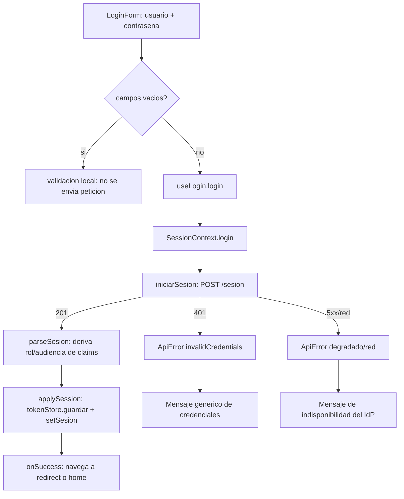
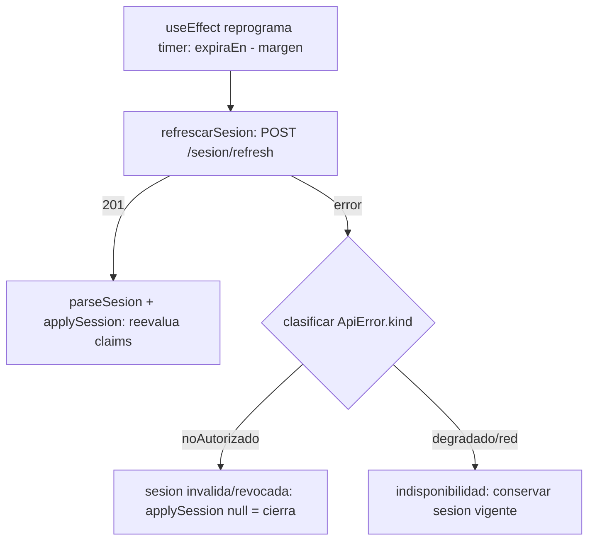

# Design Document

## Overview

E8-T5 implementa el inicio de sesión del Portal Interno (`pf-web-frontend-internal`) y el transporte opcional del segundo factor. Satisface la HU E4-HU-017 y los Requirements 1–6 del `requirements.md` de esta carpeta.

El Portal Interno **no** implementa política de autenticación: la emisión de credenciales, la validación del segundo factor (TOTP nativo de Keycloak, DEC-031 enmendada por DEC-071), y las políticas de reintento y bloqueo residen en el Proveedor de Identidad. El portal captura credenciales, transporta lo que el IdP exige, concede la sesión que el backend emite, deriva rol y organización de los claims del token, y comunica los estados de error sin filtrar información sensible (Requirement 6).

La mayor parte del comportamiento ya existe en la capa de sesión del repo y este diseño lo describe como tal, sin reescribirlo. Hay dos cambios puntuales y localizados:

1. **Distinguir la indisponibilidad del IdP del fallo de credenciales** en el mensaje de error (Requirement 4.1, 4.2).
2. **Preservar la sesión vigente cuando un refresco falla por indisponibilidad** —no por sesión inválida— (Requirement 4.4). Esto **contradice** el comportamiento actual del `useEffect` de refresco en `SessionContext.tsx`, que hoy cierra la sesión ante **cualquier** fallo de refresco.

La captura y el envío del segundo factor quedaron desbloqueados por `@ai27-tech/contracts@0.1.0-tracer.20`. Permanece una brecha externa de Identidad: el runtime todavía no distingue un OTP inválido de credenciales inválidas, por lo que el frontend conserva el mensaje genérico ante cualquier `401`.

> Nota sobre la dependencia externa: el frontend consume la superficie **pública** del bff (`POST /sesion`, vía `@ai27-tech/contracts/openapi/bff`). El campo `segundo_factor` ya existe en tracer.20. La distinción del error TOTP queda pendiente de Identidad porque Keycloak/Identidad colapsan actualmente ese caso con el rechazo de credenciales.

## Architecture

El flujo de sesión mantiene cuatro capas, cada una con una sola responsabilidad. features/ y routes/ hablan con el wrapper de dominio, nunca con el cliente HTTP.

| Capa                 | Archivo                                                           | Responsabilidad                                                                                                                                                          |
| -------------------- | ----------------------------------------------------------------- | ------------------------------------------------------------------------------------------------------------------------------------------------------------------------ |
| Cliente HTTP         | `src/lib/api/client.ts`                                           | Única puerta de salida HTTP contra bff (`${API_BASE_URL}${API_PREFIX}${path}`). Traduce fallos a `ApiError` con `kind`; soporta 204; lee `codigo` de negocio del cuerpo. |
| Taxonomía de errores | `src/lib/api/errors.ts`                                           | `ApiError` con `kind` y `kindFromStatus` (401/403→`noAutorizado`, 404→`noEncontrado`, 409→`conflicto`, ≥500→`degradado`, resto→`red`).                                   |
| Wrapper de dominio   | `src/lib/api/sesion.ts`                                           | `iniciarSesion`, `refrescarSesion`, `cerrarSesion`. Traduce wire → modelo con `parseSesion`. Reclasifica `noAutorizado` del login como `invalidCredentials`.             |
| Contrato de sesión   | `src/lib/contracts/sesion.ts`                                     | Tipos del wire desde el contrato; `parseSesion` deriva `Usuario` (rol/audiencia) de los claims del JWT.                                                                  |
| Custodia del token   | `src/lib/api/tokenStore.ts`                                       | Interfaz `TokenStore` (provisional sobre localStorage, clave `ai27.panel.sesion`).                                                                                       |
| Contexto             | `src/context/SessionContext.tsx`                                  | Estado vivo de la sesión; `login`/`logout`; hidratación; refresco con margen.                                                                                            |
| Feature (hook)       | `src/features/sesion/useLogin.ts`                                 | Traduce `ApiError.kind` → mensaje de UI; expone `submitting`/`error`.                                                                                                    |
| Feature (UI)         | `src/features/sesion/LoginForm.tsx`                               | Formulario hoja; estado de interacción; compone `@ai27-tech/ui`.                                                                                                         |
| Rutas                | `src/routes/(auth)/login.tsx`, `src/routes/(auth)/two-factor.tsx` | Ruta pública de login (redirección por `?redirect=`) y placeholder de segundo factor.                                                                                    |

### Flujo de login



### Flujo de refresco con margen



El nodo `F` es el cambio que introduce este diseño; hoy todas las ramas de error caen en `E`.

## Components and Interfaces

### `src/lib/api/sesion.ts` — sin cambios

`iniciarSesion(credenciales: CredencialesEntrada)` hace `POST /sesion` y, cuando el error es `noAutorizado`, lo re-lanza como `ApiError('invalidCredentials')`. Este es el punto que garantiza un **único** mensaje de credenciales: el 401 del IdP, sea por usuario inexistente o por contraseña incorrecta, llega siempre como el mismo `kind` (Requirement 1.4, 1.5).

`refrescarSesion(refreshToken)` hace `POST /sesion/refresh`. `cerrarSesion(accessToken)` hace `DELETE /sesion`. Todas usan `parseSesion`. No requieren modificación.

### `src/lib/api/errors.ts` — sin cambios

La taxonomía ya distingue `invalidCredentials`, `noAutorizado`, `degradado` y `red`, que es la base para separar "credenciales" de "indisponibilidad" (Requirement 4). No se agregan `kind` nuevos.

### `src/features/sesion/useLogin.ts` — cambio menor

El mapeo actual ya cubre `invalidCredentials`, `red`, `degradado` y un genérico. El cambio es afinar los mensajes para cumplir el Requirement 4.2 (no atribuir el error a las credenciales cuando el IdP no está disponible):

- `invalidCredentials` → mensaje genérico de credenciales (Requirement 1.4, 1.5). Ya existe.
- `degradado` y `red` → mensaje de **indisponibilidad del servicio de identidad**, distinguible del de credenciales y sin culpar al usuario (Requirement 4.1, 4.2). `degradado` ya tiene mensaje; se revisa la redacción y se asegura que `red` no caiga en el genérico de login sino en el de indisponibilidad/conexión.
- default → genérico de fallo de login.

La distinción credenciales vs indisponibilidad vive **aquí**, en `useLogin` (presentación), apoyada en la clasificación que ya hizo `sesion.ts`/`client.ts`. No se inventa clasificación nueva en capas bajas.

### `src/features/sesion/LoginForm.tsx` — cambio menor (validación local)

El `handleSubmit` actual llama a `login` sin validar campos vacíos. El Requirement 1.2 exige impedir el envío cuando usuario o contraseña están vacíos y mostrar validación local del campo requerido. El cambio: antes de llamar `login`, comprobar que `email` y `password` no estén vacíos (tras `trim`); si alguno lo está, marcar el campo requerido con el prop `error`/`required` del `FormField` de `@ai27-tech/ui` y **no** emitir la petición. Se reutilizan los componentes ya presentes; no se crea ninguno nuevo.

El segundo factor, de llegar a implementarse, entraría aquí como un `Input` opcional dentro de un `FormField` de la misma librería (ver brecha). No se agrega hoy.

### `src/context/SessionContext.tsx` — cambio puntual en el `useEffect` de refresco

Hoy el callback del timer hace:

```
try { applySession(await refrescarSesion(refreshToken)); }
catch { applySession(null); } // cierra ante CUALQUIER fallo
```

El Requirement 4.4 exige preservar la sesión vigente cuando el refresco falla por **indisponibilidad**. El cambio localizado: clasificar el error capturado por `ApiError.kind`:

- `noAutorizado` → la sesión dejó de ser válida (revocada/expirada/refresh inválido): `applySession(null)` (cierra). Comportamiento actual, correcto para este caso.
- `degradado` o `red` → indisponibilidad del IdP: **conservar** la sesión vigente (no llamar `applySession(null)`) y dejar que el ciclo de reprogramación vuelva a intentar más adelante.
- cualquier otro `kind` o error no-`ApiError` → conservador: mantener la sesión (no cerrar por un fallo ambiguo).

El cambio es mínimo: solo la rama `catch` del callback del timer. El resto del `useEffect` (cálculo del `delay`, reprogramación, limpieza del timer) no cambia. `login`, `logout`, `applySession` e hidratación quedan igual.

### `src/lib/contracts/sesion.ts` — sin cambios (ya cumple el Requirement 3)

`parseSesion` decodifica el `access_token`, deriva `Usuario` = { id, rol, audiencia } de los **claims** (no del cuerpo) y lanza `SesionInvalidaError` si el token no decodifica o el rol no es válido. Esto satisface el Requirement 3.2 y 3.4: el rol y la organización se determinan y se reevalúan desde los claims tanto en el login como en cada refresco (ambos pasan por `parseSesion`). No se reconstruye; el diseño verifica que ya cumple.

### `src/lib/api/tokenStore.ts` — sin cambios (ya cumple el Requirement 3.1, 3.5)

`guardar`/`limpiar` persisten y descartan la sesión completa (incluye `accessToken` y `refreshToken`). El login persiste vía `applySession(sesion)`; el logout descarta vía `applySession(null)` antes del `DELETE /sesion` best-effort. Provisional sobre localStorage, aislado tras la interfaz `TokenStore`.

### Rutas — `login.tsx` sin cambios; `two-factor.tsx` se mantiene placeholder

`login.tsx` ya redirige con `beforeLoad` si hay sesión y navega a `?redirect=` o home tras el éxito (Requirement 1.6). No cambia.

`two-factor.tsx` se mantiene como placeholder. Dado que el wire del segundo factor es de **una sola llamada** (el TOTP viaja en el cuerpo del mismo `POST` de login), lo más probable es que el TOTP sea un **campo opcional del propio `LoginForm`** y no una pantalla posterior de dos pasos. Esa decisión y su implementación quedan supeditadas a que el bff publique el campo (ver brecha). Hasta entonces, no se le añade lógica.

## Data Models

Se reutilizan los tipos existentes; no se inventan campos.

- **`CredencialesEntrada`** (`src/lib/contracts/sesion.ts`, derivado de `@ai27-tech/contracts/openapi/bff`): { `usuario`, `contrasena`, `segundo_factor?: string | null` }. El campo se envía solo cuando el usuario captura un código.
- **`RefrescoEntrada`**: { `refresh_token` }.
- **`SesionWire`**: forma del wire; { `sesion_id`, `access_token`, `refresh_token?`, `expira_en` (RFC 3339) }.
- **`Sesion`** (modelo de app): { `sesionId`, `accessToken`, `refreshToken?`, `expiraEn` (epoch ms), `usuario` }.
- **`Usuario`**: { `id`, `rol`, `audiencia` } derivado de los claims del JWT.

El rol y la audiencia **no** viajan en el cuerpo de la sesión: se derivan de los claims en `parseSesion`. El segundo factor viaja opcionalmente en el cuerpo del mismo login; no existe una operación separada de verificación.

## Correctness Properties

_Una propiedad es una característica o comportamiento que debe cumplirse en todas las ejecuciones válidas del sistema: una afirmación formal sobre lo que el sistema debe hacer. Las propiedades son el puente entre una especificación legible para humanos y una garantía de corrección verificable por máquina._

### Property 1: Mensaje de credenciales único e indistinto de la existencia de la cuenta

_Para cualquier_ respuesta `401` del login, el mensaje presentado al usuario es exactamente el mensaje genérico de credenciales, idéntico para un usuario existente y uno inexistente, sin variar con el valor de `usuario`.

**Validates: Requirements 1.4, 1.5**

### Property 2: No se emite petición de login con campos vacíos

_Para cualquier_ par (usuario, contraseña) en el que al menos uno sea una cadena vacía o compuesta solo por espacios en blanco, el envío del formulario no emite ninguna petición `POST /sesion` y marca el campo requerido como inválido.

**Validates: Requirements 1.2**

### Property 3: La indisponibilidad del IdP produce un mensaje distinto del de credenciales

_Para cualquier_ `ApiError` cuyo `kind` sea `degradado` o `red`, `useLogin` produce el mensaje de indisponibilidad del servicio de identidad, y ese mensaje nunca coincide con el mensaje genérico de credenciales.

**Validates: Requirements 4.1, 4.2**

### Property 4: Un fallo de refresco por indisponibilidad nunca cierra una sesión vigente

_Para cualquier_ sesión vigente y cualquier fallo de refresco, si el `kind` del fallo es `degradado` o `red` la sesión se conserva sin cambios, y solo si el `kind` es `noAutorizado` la sesión se cierra.

**Validates: Requirements 4.4**

### Property 5: Ningún fallo de login concede una nueva sesión

_Para cualquier_ fallo de `iniciarSesion` (cualquier `kind` de `ApiError`), el estado de sesión del portal no pasa a una nueva `Sesion`: la sesión concedida solo cambia ante una respuesta exitosa.

**Validates: Requirements 4.3**

### Property 6: El rol y la audiencia se derivan de los claims del token

_Para cualquier_ `access_token`, `parseSesion` produce un `Usuario` cuyo rol y audiencia provienen de los claims cuando el rol es válido, y lanza `SesionInvalidaError` cuando el token no decodifica o el rol no es reconocido. Esto aplica por igual al login y al refresco, pues ambos pasan por `parseSesion`.

**Validates: Requirements 3.2, 3.4**

### Property 7: Round-trip de persistencia de la sesión

_Para cualquier_ `Sesion`, guardarla en el `TokenStore` y luego cargarla reproduce sus tokens (`accessToken`, `refreshToken`) y sus campos persistidos de forma equivalente.

**Validates: Requirements 3.1**

## Error Handling

La UI nunca presenta el `mensaje` crudo del `ApiError`; `useLogin` traduce el `kind` a un mensaje para el operador. La distinción entre credenciales, indisponibilidad y revocación se apoya en la clasificación que ya hacen `client.ts` (`kindFromStatus`) y `sesion.ts` (reclasificación de `noAutorizado` → `invalidCredentials` en el login).

| `kind`                          | Origen                                                    | Mensaje de UI                                                         | Requerimiento |
| ------------------------------- | --------------------------------------------------------- | --------------------------------------------------------------------- | ------------- |
| `invalidCredentials`            | `401` en `POST /sesion`, reclasificado en `iniciarSesion` | Mensaje genérico de credenciales ("Correo o contraseña incorrectos.") | 1.4, 1.5      |
| `degradado`                     | `≥500` del bff/IdP                                        | Indisponibilidad del servicio de identidad, sin culpar al usuario     | 4.1, 4.2      |
| `red`                           | Fallo de red o respuesta no interpretable                 | Indisponibilidad/conexión, sin culpar al usuario                      | 4.1, 4.2      |
| `noAutorizado` (en refresco)    | `401/403` en `POST /sesion/refresh`                       | Sesión inválida/revocada → se cierra la sesión                        | 4.4           |
| `degradado`/`red` (en refresco) | Fallo transitorio al refrescar                            | Se conserva la sesión vigente; sin mensaje de cierre                  | 4.4           |
| otros / no-`ApiError`           | Inesperado                                                | Genérico de fallo de login (login) o conservador (refresco)           | —             |

Tres caminos de error se tratan distinto a propósito: **credenciales** (culpa recuperable del usuario, mensaje genérico que no filtra existencia de cuenta), **indisponibilidad** (fuera del control del usuario, no se le atribuye y, en refresco, no cierra la sesión) y **revocación/expiración** (la sesión ya no vale, se cierra).

## Testing Strategy

Enfoque dual: pruebas unitarias/ejemplo para caminos concretos y de borde, y pruebas basadas en propiedades para las propiedades universales anteriores. El transporte del segundo factor se verifica con pruebas unitarias y e2e. El mensaje específico de TOTP permanece diferido por la brecha externa de Identidad.

**Librería de PBT:** usar `fast-check` junto al runner del repo (Vitest), sin implementar PBT a mano. Cada prueba de propiedad corre mínimo 100 iteraciones y se etiqueta con un comentario de la forma **Feature: e8-t5-login-segundo-factor, Property {n}: {texto}**.

Pruebas de propiedad (una por propiedad):

- **Propiedad 1** — generar valores de `usuario` arbitrarios; para todo `401`, el mensaje es el genérico de credenciales.
- **Propiedad 2** — generar pares con al menos un campo vacío/solo-espacios; verificar que `iniciarSesion` no se invoca.
- **Propiedad 3** — generar `ApiError` de `kind` `degradado`/`red`; verificar mensaje de indisponibilidad y que difiere del de credenciales.
- **Propiedad 4** — generar sesiones vigentes y `kind` de fallo de refresco; verificar conservar vs cerrar según `kind`.
- **Propiedad 5** — generar fallos de login de cualquier `kind`; verificar que no se concede sesión nueva.
- **Propiedad 6** — generar claims con rol válido/ inválido y tokens no decodificables; verificar derivación de rol/audiencia o `SesionInvalidaError`.
- **Propiedad 7** — generar `Sesion` arbitrarias; round-trip `guardar`→`cargar`.

Pruebas unitarias/ejemplo:

- `useLogin`: mapeo de cada `kind` a su mensaje (incluye el nuevo mensaje de indisponibilidad).
- `iniciarSesion`: construye `POST /sesion` con `{ usuario, contrasena }` (Req 1.1); reclasifica `401` a `invalidCredentials`.
- `parseSesion`: casos de token válido, rol inválido y token no decodificable (complementa la Propiedad 6).
- `SessionContext`: con timers falsos, el refresco se dispara con margen (Req 3.3); `logout` limpia el store y llama `cerrarSesion` best-effort (Req 3.5).
- `login.tsx`: redirección a `?redirect=` y a home (Req 1.6).

Pruebas e2e:

- **login → panel**: credenciales válidas conceden sesión y navegan al destino.
- **Segundo factor:** el e2e verifica captura y envío del código en el mismo request. El e2e del mensaje específico queda pendiente de la brecha externa de Identidad.

Composición de UI (Req 5): verificación por inspección de que `LoginForm` solo usa componentes de `@ai27-tech/ui` (`Card`, `CardBody`, `Form`, `FormField`, `Input`, `Checkbox`, `Button`) y no define ninguno propio.

## Brechas de contrato y trabajo diferido

### Brecha externa: Identidad no distingue el rechazo de TOTP

El Portal Interno consume la superficie pública del bff vía `@ai27-tech/contracts/openapi/bff`: `POST /api/v1/sesion`, `POST /api/v1/sesion/refresh` y `DELETE /api/v1/sesion`. El contrato `v0.1.0-tracer.20` ya contiene `CredencialesEntrada.segundo_factor?: string | null`.

El transporte del Segundo_Factor está implementado en el frontend: el campo se captura de forma opcional y se envía en el mismo `POST /sesion` solo cuando tiene valor.

La brecha restante es externa al frontend. Con el grant directo ROPC, Keycloak devuelve `invalid_grant` tanto para credenciales inválidas como para OTP inválido. Identidad clasifica ambos casos como `ErrCredencialInvalida`. No existe todavía un `codigo` estable para que el frontend muestre un mensaje específico de Segundo_Factor inválido.

Mientras Identidad no publique esa distinción:

1. el frontend conserva el mensaje genérico para todo `401` de login;
2. no se inventa un `Error.codigo` ni se simula en los mocks;
3. el e2e cubre captura y transporte, pero no el mensaje específico.

**Desbloqueo futuro:** Identidad/Seguridad debe distinguir el rechazo de OTP, emitir un código estable y publicarlo mediante el contrato del bff. Entonces el frontend conservará ese código en `iniciarSesion`, lo mapeará en `useLogin` y agregará la prueba del mensaje específico.

### Contradicción requirement ↔ contrato

La documentación histórica describía una brecha del campo `segundo_factor` contra tracer.18. Esa brecha quedó resuelta en tracer.20. La dependencia vigente es la distinción runtime del error de TOTP, registrada en `solicitud-contrato-bff-segundo-factor.md` como brecha externa de Identidad.
