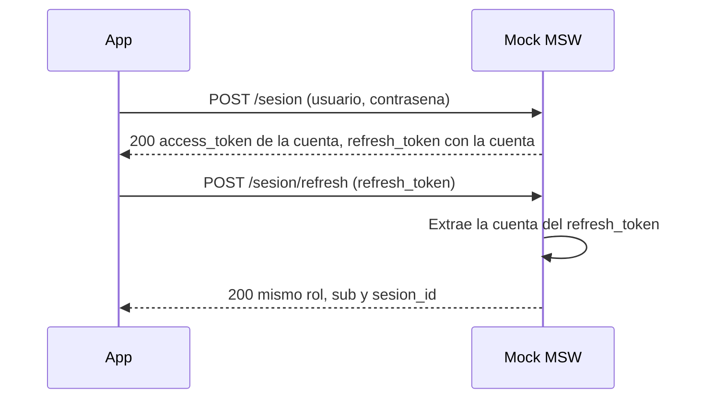

# Diseño: Modo mock con inicio de sesión por rol interno

|                 |                                                                                 |
| --------------- | ------------------------------------------------------------------------------- |
| **Tipo**        | Feature                                                                         |
| **Flujo**       | Requirements-First. Fase 2 de 3 (diseño). Tareas pendientes                     |
| **Repositorio** | `pf-web-frontend-internal`                                                      |
| **Requisitos**  | `requirements.md` del mismo directorio (Requisitos 1 a 4)                       |
| **Estado**      | Aprobado en lo que respecta a preguntas abiertas. Pendiente de aprobación final |

## Overview

El mock pasa de una cuenta a siete. Un catálogo en `src/mocks/data.ts` define las cuentas demo, y de cada cuenta se derivan `sub` y `sesion_id`. `POST /sesion` valida contra ese catálogo. `POST /sesion/refresh` identifica la cuenta a partir del `refresh_token`. El mock de conversaciones sigue al sujeto de la cuenta que inició sesión. Las credenciales demo quedan fuera del build sin modo mock.

Las dos preguntas abiertas están resueltas y no cambian la estructura (ver Riesgos y dependencias).

## Architecture

### Renovación: el `refresh_token` identifica la cuenta

`POST /sesion/refresh` recibe solo `{ refresh_token }` (verificado en `src/lib/api/sesion.ts`). El mock necesita otra forma de saber qué sesión renovar.

**Decisión:** el `refresh_token` codifica la cuenta. `createSessionWire(cuenta)` emite `mock.refresh.<cuenta>.<uuid>`. El refresh extrae la cuenta con la expresión `^mock\.refresh\.([a-z]+)\.[0-9a-f-]{36}$` y la busca en el catálogo. Si la cuenta existe, responde con `createSessionWire(cuenta)`. El rol, el `sub` y el `sesion_id` salen de la cuenta, así que se conservan.



Alternativas consideradas:

| Opción                                          | Ventaja                                     | Costo                                                                                                   | Resultado   |
| ----------------------------------------------- | ------------------------------------------- | ------------------------------------------------------------------------------------------------------- | ----------- |
| A. Codificar la cuenta en el `refresh_token`    | Sin estado. Cada token identifica su sesión | El token deja de ser opaco. Es aceptable, porque el mock ya emite tokens falsos                         | **Elegida** |
| B. Mapa en memoria de `refresh_token` a cuenta  | Token opaco                                 | Estado de módulo que hay que reiniciar. Requiere política para tokens desconocidos                      | Descartada  |
| C. Usar la cuenta del último login              | Trivial                                     | El refresh depende del orden de logins, no del token que recibe                                         | Descartada  |
| D. Leer la cuenta del `access_token` del header | No cambia el `refresh_token`                | El access token suele estar vencido al refrescar. No verificado si el cliente lo envía en este endpoint | Descartada  |

Sobre la opción B: `tokenStore` guarda el `refreshToken` solo en memoria (verificado en `src/lib/api/tokenStore.ts`). Una recarga de página ya descarta el refresh, así que la razón a favor de A no es la persistencia. La razón es que el token lleva su propia identidad.

El corte de sesión (`x-mock-session-cut` y la cookie `ai27-mock-session-cut`) se evalúa antes que la cuenta, como hoy.

### Exclusión del build de producción

Estado verificado:

- `src/main.tsx` aplica `if (import.meta.env.VITE_ENABLE_MOCKS !== 'true') return;` antes de `import('./mocks/browser')`.
- `vite.config.ts` no define esa variable (búsqueda sin coincidencias).
- `.env.mock` define `VITE_ENABLE_MOCKS=true`. Por convención de Vite, solo se carga con `--mode mock` (`dev:mock` y `build:mock`).
- `dist/assets/browser-eHn3TrBO.js` contiene coincidencias de `demo1234` y `operador@demo.ai27`.

No verificado: si Rollup elimina el chunk de mocks en `pnpm build`, y qué comando generó el `dist` actual. El `dist` existente no dice nada sobre un build sin modo mock.

Cambio propuesto: ninguno en `src/` si la verificación de abajo pasa. Si no pasa, se revisa el guard. Una opción es fijar `import.meta.env.VITE_ENABLE_MOCKS` como literal con `define` en `vite.config.ts`. Esa opción se decide según el resultado.

Verificación propuesta (no ejecutada):

1. Ejecutar `pnpm build`. Es el script de `package.json` (`tsc --build --force && vite build`). Sin `VITE_ENABLE_MOCKS` en el entorno ni en `.env.local`.
2. Buscar en `dist/` las cadenas `demo1234` y `@demo.ai27`, sin distinguir mayúsculas. Comando de referencia: `Get-ChildItem dist -Recurse -File | Select-String -SimpleMatch -Pattern 'demo1234','@demo.ai27'`. Resultado esperado: sin coincidencias.
3. Control positivo: `pnpm build:mock` debe sí contener esas cadenas. Sin este control, el paso 2 no demuestra nada.

Riesgo: un `.env.local` con `VITE_ENABLE_MOCKS=true` en una máquina de desarrollo incluiría los mocks en `pnpm build`. El paso 2 lo detecta.

## Components and Interfaces

### Cambios sobre el código actual

| Archivo                 | Símbolo                           | Hoy                                                       | Cambio                                                    | Requisito |
| ----------------------- | --------------------------------- | --------------------------------------------------------- | --------------------------------------------------------- | --------- |
| `src/mocks/data.ts`     | `DEMO_CREDENTIALS`, `DEMO_CLAIMS` | Un operador. `sub` `usr-demo-1`, `sesion_id` `ses-demo-1` | Se sustituyen por `CUENTAS_DEMO` y funciones derivadas    | 1, 2      |
| `src/mocks/data.ts`     | `createSessionWire()`             | Sin parámetro. Siempre `ses-demo-1`                       | Recibe la cuenta. Emite `refresh_token` con la cuenta     | 2, 3      |
| `src/mocks/data.ts`     | `mockAccessToken(rol)`            | Claims fijos de `DEMO_CLAIMS`                             | Conserva la firma. Deriva los claims de la cuenta del rol | 1, 2      |
| `src/mocks/data.ts`     | `SUJETO_CONVERSACIONES_DEMO`      | Igual a `DEMO_CLAIMS.sub`                                 | Igual al `sub` de la cuenta por defecto                   | 2         |
| `src/mocks/handlers.ts` | `POST /sesion`                    | Solo acepta `operador@demo.ai27`                          | Busca en el catálogo y responde 401 si no coincide        | 1         |
| `src/mocks/handlers.ts` | `POST /sesion/refresh`            | Siempre `createSessionWire()`, rol `jefe_operativo`       | Lee la cuenta del `refresh_token`                         | 3         |
| `.env.example`, README  | Documentación de la credencial    | Solo menciona `operador@demo.ai27`                        | Documentar las siete cuentas al implementar               | 1         |

Ningún cambio en `main.tsx` ni en `vite.config.ts` está previsto (ver Architecture).

### Funciones auxiliares

- `cuentaPorCredenciales(usuario, contrasena)`: busca la cuenta. La comparación es exacta, con mayúsculas y minúsculas (supuesto del Requisito 1).
- `cuentaPorRol(rol)`: busca la cuenta de un rol. Supone correspondencia uno a uno (ver Riesgos).
- `cuentaPorRefreshToken(token)`: aplica la expresión regular y busca la cuenta.
- `sujetoDeCuenta(cuenta)` y `sesionDeCuenta(cuenta)`: plantillas `usr-demo-<cuenta>` y `ses-demo-<cuenta>`.

### Inicio de sesión (`POST /sesion`)

1. Leer `usuario` y `contrasena` del cuerpo. Si el cuerpo no es JSON o faltan campos, se tratan como vacíos. Hoy `request.json()` lanzaría una excepción en ese caso.
2. Buscar la cuenta con `cuentaPorCredenciales`. Si no hay coincidencia, responder `401` con `{ mensaje: 'Credenciales inválidas' }`, sin `access_token`.
3. Si hay coincidencia, reiniciar el estado de conversaciones con el sujeto de la cuenta (ver más abajo) y responder `200` con `createSessionWire(cuenta)`.

### Renovación (`POST /sesion/refresh`)

1. Evaluar el corte de sesión, como hoy.
2. Extraer la cuenta del `refresh_token`. Si no hay cuenta, responder `401` con `{ mensaje: 'Refresh token inválido' }`.
3. Responder `200` con `createSessionWire(cuenta)`.

### Sujeto activo en conversaciones

Búsqueda en `src/`: el único lector de `DEMO_CLAIMS.sub` es `SUJETO_CONVERSACIONES_DEMO`. El único lector de `DEMO_CLAIMS.sesion_id` es `createSessionWire`. El `rol` llega al roster por el token, mediante `decodificarClaims`, y ese flujo no cambia.

Cambio mínimo:

- `SUJETO_CONVERSACIONES_DEMO` pasa a ser `sujetoDeCuenta('operador')`, es decir, `usr-demo-operador`. Conserva el nombre, así que `tests/conversaciones/BandejaConversaciones.test.tsx` no cambia.
- `POST /sesion` reinicia el estado con `reiniciarConversacionesMock({ sujetoId })`. La función ya existe. El refresh no reinicia nada.
- No se usa `cambiarSujetoConversacionesMock`. Esa función solo cambia `estadoConversaciones.sujetoId`. Las conversaciones se crean con `responsableId: sujetoId` (`crearEstadoConversaciones`, `data.ts`), así que seguirían reclamadas por la cuenta anterior.
- Costo del reinicio: también se borran los fallos forzados y las solicitudes registradas. Supuesto: un login es una sesión nueva y es aceptable.
- El frontend no cambia. El sujeto de la app sale de `usuario.id`, que viene del token (`useConversacion.ts`, `BandejaConversaciones.tsx`).
- `OTRO_RESPONSABLE_DEMO = 'usr-demo-2'` no cambia. No es un rol interno y no choca con `usr-demo-<cuenta>`.

Revisar al implementar (no bloquean):

- `tests/conversaciones/BandejaConversaciones.test.tsx`, línea 64: `usr-demo-1` queda sobrescrito por `iniciarSesionComo(SUJETO)` en `beforeEach`.
- `tests/viajes/CrearViaje.test.tsx`, línea 27: usa `usr-demo-1` como dato local. La búsqueda no encontró acoplamiento con el mock, pero no leí el archivo completo.
- `e2e/login.spec.ts`, `e2e/roster.spec.ts` y `e2e/session-cut.spec.ts` entran con `operador@demo.ai27`. Siguen válidos porque la cuenta se conserva.

## Data Models

### Catálogo de cuentas

Una fila por rol interno es la única fuente de verdad. Todo lo demás se calcula a partir de la cuenta.

```ts
/** Contraseña común de las cuentas demo. Decisión confirmada por el usuario. */
const CONTRASENA_DEMO = 'demo1234';

export const CUENTAS_DEMO = [
  { cuenta: 'operador', rol: Rol.JefeOperativo },
  { cuenta: 'monitorista', rol: Rol.Monitorista },
  { cuenta: 'supervisor', rol: Rol.Supervisor },
  { cuenta: 'coordinador', rol: Rol.Coordinador },
  { cuenta: 'ejecutivo', rol: Rol.Ejecutivo },
  { cuenta: 'reaccion', rol: Rol.Reaccion },
  { cuenta: 'administrador', rol: Rol.Administrador },
] as const;
```

Campos derivados:

| Campo                | Valor                    | Origen              |
| -------------------- | ------------------------ | ------------------- |
| Usuario              | `<cuenta>@demo.ai27`     | Plantilla           |
| Contraseña           | `CONTRASENA_DEMO`        | Decisión confirmada |
| Rol (`rol`)          | Columna `rol` de la fila | Catálogo            |
| Sujeto (`sub`)       | `usr-demo-<cuenta>`      | Plantilla           |
| Sesión (`sesion_id`) | `ses-demo-<cuenta>`      | Plantilla           |

- `sub` y `sesion_id` no se escriben a mano en ningún otro lugar.
- La unicidad (Requisito 2.3) se sigue de que la cuenta es única en el catálogo. Una prueba la verifica.
- El código ya usa varios miembros de `Rol`. `src/features/monitoreo/puedeUsarMonitoreo.ts` usa `Monitorista`, `Supervisor`, `Coordinador` y `Administrador`. `src/features/viajes/historico/visibilidadCorreccion.ts` usa `Supervisor` y `Coordinador`. Los siete roles internos existen en `node_modules/@ai27-tech/contracts/src/roles/roles.gen.ts`.

### Formato del `refresh_token`

`mock.refresh.<cuenta>.<uuid>`, donde `<uuid>` es el resultado de `crypto.randomUUID()`. La cuenta es el único dato que el refresh necesita. El token no se usa como secreto.

## Error Handling

- Credencial inválida, vacía, ausente o cuerpo que no es JSON: `401` sin `access_token`.
- `refresh_token` que no corresponde a una cuenta: `401`. Antes el mock renovaba cualquier token como `jefe_operativo`. El cambio solo afecta tokens que el mock no emitió. Como el refresh vive solo en memoria, no quedan tokens persistidos entre recargas.
- Corte de sesión: sin cambios.

## Testing Strategy

PBT no aplica. El dominio es finito (siete cuentas) y todos los casos se pueden enumerar. Por eso la sección Correctness Properties se omite. Se usan pruebas por ejemplo sobre el catálogo completo, en `tests/` (carpeta por confirmar):

- Por cada cuenta: el login devuelve `rol`, `sub` y `sesion_id` del catálogo en el token. (1.1, 1.2, 2.1, 2.2)
- Por cada cuenta: el refresh devuelve el mismo rol, `sub` y `sesion_id`. (3.1)
- Entre las siete cuentas, `sub` y `sesion_id` no se repiten. (2.3)
- Credenciales inválidas, vacías, ausentes o JSON inválido: `401` sin `access_token`. (1.3)
- Tras iniciar sesión como `monitorista`, `sujetoConversacionesMock()` devuelve `usr-demo-monitorista`. (Impacto de la decisión 4)
- Build: el procedimiento de Architecture. Es verificación manual o de script, no prueba unitaria.

## Riesgos y dependencias

| Tema                                                                                  | Si la respuesta es distinta                                 | Impacto                                                                      |
| ------------------------------------------------------------------------------------- | ----------------------------------------------------------- | ---------------------------------------------------------------------------- |
| **Pregunta 1 (resuelta).** ¿La contraseña es `demo1234` en las siete cuentas?         | Resuelta: sí. Decisión confirmada por el usuario. No aplica | Ninguno. La contraseña común se mantiene en `CONTRASENA_DEMO`                |
| **Pregunta 2 (resuelta).** ¿Son aceptables `usr-demo-<cuenta>` y `ses-demo-<cuenta>`? | Resuelta: sí. Formatos aceptados. No aplica                 | Ninguno. Las pruebas nuevas deben leer las plantillas, no escribir literales |

Otros riesgos y dependencias:

- **Correspondencia uno a uno entre rol y cuenta.** `mockAccessToken(rol)` depende de ella. Si dos cuentas comparten rol, hay que pasar la cuenta de forma explícita.
- **Miembros de `Rol`** para seis roles no confirmados con búsqueda.
- **Expresión del `refresh_token`.** Supone que las cuentas no contienen puntos.
- **Codificación de `handlers.ts`.** Algunos mensajes del archivo se leen con texto dañado (`inv├ílidas`, `Sesi├│n`). Hay que verificar que el archivo esté en UTF-8 antes de editarlo. No verificado si el problema está en el archivo o solo en la lectura.
- **Documentación.** `.env.example` y el README solo mencionan `operador@demo.ai27`. Se actualizan al implementar.
- **Build.** La exclusión del build no está verificada (ver Architecture).

## Mapa requisito → sección de diseño

| Requisito                   | Sección                                               |
| --------------------------- | ----------------------------------------------------- |
| 1.1, 1.2                    | Data Models (catálogo), Components (inicio de sesión) |
| 1.3                         | Components (inicio de sesión), Error Handling         |
| 2.1, 2.2, 2.3               | Data Models (campos derivados)                        |
| 2, impacto de la decisión 4 | Components (sujeto activo en conversaciones)          |
| 3.1                         | Architecture (renovación), Components (renovación)    |
| 4.1, 4.2                    | Architecture (exclusión del build de producción)      |

No se agregaron requisitos. Los casos de error de Error Handling se derivan de las frases "inválida", "vacía" y "ausente" del Requisito 1.3.
